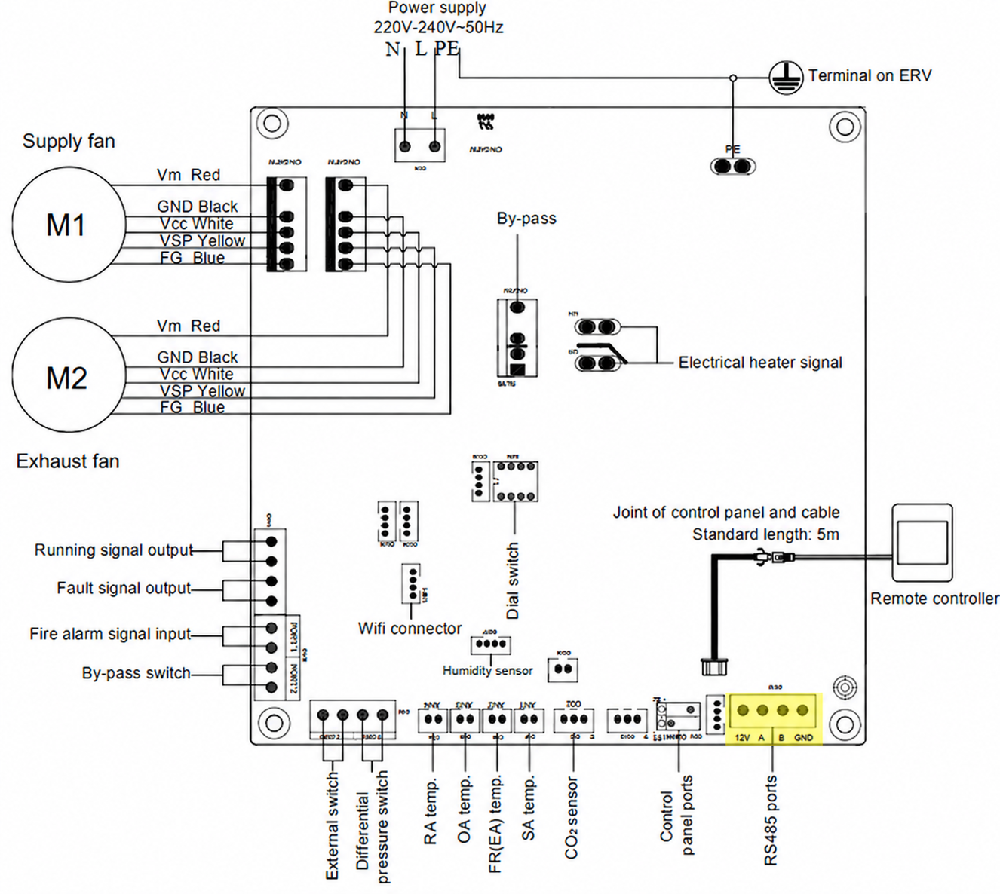

<p align="center">
  
</p>

[Русский](readme.md)

# RoyalClima · ESPHome

ESPHome firmware connecting an ESP32 to a **Royal Clima SOFFIO Primo** heat recovery ventilation unit over **Modbus RTU / RS-485**. The series includes **RCS-250-P, RCS-350-P, RCS-500-P and RCS-650-P**. Tested on **RCS-650-P**; other models and controller revisions need verification.

Potential compatibility with **Holtop** units using the same protocol and register map: **XHBQ-D1.5DMTHA, XHBQ-D2.5DMTHA, XHBQ-D3.5DMTHA, XHBQ-D5DMTHA, XHBQ-D6.5DMTHA, XHBQ-D8DMTHA, XHBQ-D10DMTHA, XHBQ-D13DMTHA, XHBQ-D15DMTHA, XHBQ-D20DMTHA and XHBQ-D26DMTHA**. These models have not been tested.

Use the local web interface independently, connect to **Home Assistant** through the ESPHome native API, or configure MQTT. Standalone operation requires the API timeout setting below.

## Project files

- Compiled ESP32 firmware: [factory image for initial USB installation](bin/royalclima-firmware.factory.bin), [OTA update image](bin/royalclima-firmware.ota.bin).
- [ESPHome configuration](ESPHome/RoyalClima.yaml).
- Manufacturer documentation: [SOFFIO Primo manual](docs/2020_RC_Manual_Soffio-Primo.pdf), [DC (Primo) Modbus protocol](docs/Modbus%20protocol%20-%20DC%20%28Primo%29.pdf).
- Home Assistant: [package](Hass/packages/royal_clima.yaml), [dashboard examples](Hass/dashboard/), [SVG assets](Hass/images/), [fonts and CSS](Hass/fonts/).

## Hardware and wiring

You need an ESP32 development board, a UART-to-RS-485 transceiver with **3.3 V logic**, suitable power supplies, wiring and Wi-Fi. The configuration uses `esp32dev` with ESP-IDF.

Classic **ESP32-WROOM-32** boards such as ESP32-DevKitC or DevKit V1 are suitable when GPIO16/17/18 are available. ESP32-WROVER reserves GPIO16/17 for internal connections. Other variants, including C3 and S3, require board/GPIO adjustments and a matching build. See [ESP32-DevKitC pin restrictions](https://docs.espressif.com/projects/esp-dev-kits/en/latest/esp32/esp32-devkitc/user_guide.html).

A **3.3 V MAX3485 module** with DI, RO, DE and /RE fits the wiring below. Modules with automatic direction control require removing `uart.flow_control_pin` from your configuration. Isolated modules require wiring and power arrangements appropriate to their design. Check the complete module specification, especially the RO output voltage on 5 V modules.

| ESP32 | RS-485 module | Purpose |
|---|---|---|
| GPIO17 / TX | DI | Transmit |
| GPIO16 / RX | RO | Receive |
| GPIO18 / EN | DE and /RE joined together | High: transmit; low: receive |
| GND | Logic-side GND | UART reference |
| 3V3 | VCC of a compatible 3.3 V module | Transceiver power |

Connect module **A/B** to the unit's **A/B** terminals. Power the ESP32 through USB or its specified power input. Check terminal naming, bus reference grounding and termination against the equipment documentation; do not connect RS-485 signals directly to GPIOs.



## Firmware setup

1. Copy [RoyalClima.yaml](ESPHome/RoyalClima.yaml) into your ESPHome configuration directory. The build needs support for ESP-IDF, `esphome.devices` and the components used in the file; a minimum tested ESPHome version is not specified.
2. Create `secrets.yaml` beside it:

   ```yaml
   wifi_ssid: "Primary Wi-Fi"
   wifi_password: "Primary password"
   wifi_ssid2: "Backup Wi-Fi"
   wifi_password2: "Backup password"
   ```

   Remove the second `wifi.networks` entry if only one network is needed.
3. Check GPIOs, baud rate and Modbus address in `substitutions`.
4. Validate, compile and flash:

   ```console
   esphome config RoyalClima.yaml
   esphome run RoyalClima.yaml
   ```

   Use USB initially and ESPHome OTA for subsequent updates. The supplied factory and OTA images serve different purposes and are not interchangeable.
5. Open `http://royalclima.local/` or the ESP32 IP address. If configured Wi-Fi is unavailable, a fallback access point and captive portal are enabled after 90 seconds.

The web server runs on port 80 and serves its resources locally without an external CDN. OTA uses the ESPHome OTA component.

The YAML currently enables `api:` and leaves MQTT commented out. For standalone use without a persistent native API client, set:

```yaml
api:
  reboot_timeout: 0s
```

This disables the API's default 15-minute restart timeout; a web browser connection is not a native API connection. See [ESPHome native API](https://esphome.io/components/api/).

For [MQTT](https://esphome.io/components/mqtt/), enable `mqtt` and configure broker credentials. Remove unused `api:` or disable its restart timeout. The supplied HA package and dashboards target native API entities; check entity references and connection indicators when switching to MQTT.

API encryption, OTA password and web authentication are not configured in the supplied YAML; configure them for your network.

## Modbus behavior

| Setting | Default |
|---|---|
| Serial | 9600 baud, 8N1; SW4-4 ON = 9600, OFF = 4800 |
| Modbus address | 1; must match controller parameter 08 |
| Main polling | Every 15 s, registers 9–20 |
| Secondary polling | Every 60 s, registers 25, 27 and 769 |
| Response timeout / turnaround | 1500 ms / 600 ms |
| Command retries | 1 |
| Main / secondary stale timeout | 60 s / 180 s |

Holding registers are read using FC03: 9–20 as one block, with 25, 27 and 769 read separately. Controls write registers 9–11, 19 and 27 using FC06. No power restore command is sent on ESP32 startup.

Fan steps **0–10** map to protocol codes **0, 2, 3, 5, 8, 9, 10, 11, 12, 13, 14**. These are speed steps, not RPM or percentages. Temperatures in registers 12–15 are converted by subtracting 40.

`ESP32 connection` indicates a native API client connection. `Vent system Online` means the main register block has non-stale data. A failed command does not immediately clear Online: the last confirmed state is retained until the 60 s timeout. Before the first successful main read, Online is off. Its status is checked at intervals of up to 3 s.

Main readings become unknown after 60 s without updates; secondary readings after 180 s. Derived values follow on their next calculation. Online does not guarantee fresh secondary readings or successful command delivery. `Seconds since last data` tracks register **9**, not every response. `Offline events` counts offline transitions in both polling groups since ESP32 boot.

Logging is WARN. Standard Modbus component warnings are suppressed while ERROR messages remain; the custom retry-exhaustion warning is limited to once per minute when another failure occurs.

## Entities

Names below match the YAML. Unit entities belong to **Ventilation System**; ESP32 diagnostics belong to **Royal Clima**. HA entity IDs may differ after renaming or registry changes. Entries marked * are disabled by default in HA.

| Numeric sensors | Meaning / register |
|---|---|
| Power state raw * | Off/on code, 9 |
| Supply fan speed code *; Exhaust fan speed code * | Protocol codes, 10 / 11 |
| Return air temperature; Outdoor air temperature | Return RA / outdoor OA, °C, 12 / 13 |
| Supply Air Temperature; Defrost temperature | Supply SA / defrost sensor, °C, 14 / 15 |
| External boost signal raw *; CO2 boost signal raw * | Boost flags, 16 / 17; not CO₂ ppm |
| Status flags raw *; Error flags raw * | Bitmasks, 18 / 20 |
| Humidity setpoint; Heater temperature setpoint | Configured humidity 1–99 % / heater temperature 10–25 °C, 19 / 27 |
| Filter interval code *; Filter reminder interval | Code / configured reminder period: 45, 60, 90 or 180 days, 25; not days remaining |
| Fan runtime | Hours of operation, 769; raw unit is 0.1 h |
| Supply fan speed; Exhaust fan speed | Decoded steps 0–10 from 10 / 11 |
| Seconds since last data; Offline events | Main read age in seconds / offline transition count |
| WiFi signal; Uptime | ESP32 Wi-Fi signal in dBm / time since boot in seconds |

| Binary sensors | Meaning |
|---|---|
| ESP32 connection; Vent system Online | API connection / main Modbus data status |
| Ventilation power | Power state from register 9, not proof of fan rotation |
| Bypass open; Bypass closed * | Bypass position; Bypass open is unknown when position bits conflict or are both unset |
| Defrost active; Fire alarm | Defrost / unit fire input flags |
| Ventilation error | Nonzero error mask |
| External boost active; CO2 boost active | Boost request flags |

**Text sensors:** `Ventilation status` and `Error description` provide Russian status/error text, including the original error code. Errors cover OA/RA/EA/SA sensors, EEPROM and both fans; unknown bits are also reported.

**Controls:** `Ventilation control` switches unit power; `Supply speed control` and `Exhaust speed control` select `Стоп` (stop) or steps 1–10. `Humidity setpoint control` * and `Heater temperature setpoint control` * write the corresponding setpoints. The filter interval is read-only. Measured CO₂/humidity and bypass/defrost settings are not exposed.

`ESP32 Reboot` restarts **only the ESP32**, not the ventilation controller.

## Home Assistant package

Add the device through the **ESPHome integration**. Copy [royal_clima.yaml](Hass/packages/royal_clima.yaml) to `/config/packages/royal_clima.yaml` and merge this into your existing `homeassistant` section:

```yaml
homeassistant:
  packages: !include_dir_merge_named packages
```

The package already includes the outer `royal_clima` key. Check its source entity IDs, validate the HA configuration and restart HA.

Use these wrappers for control and automations:

- `switch.royal_clima_power`
- `select.royal_clima_supply_speed`
- `select.royal_clima_exhaust_speed`

They use confirmed readings and availability checks. They are not a safety interlock and do not guarantee freshness of every register group.

The package also provides:

- `sensor.royal_clima_filter_usage`: runtime hours / (configured interval days × 24) × 100, rounded to one decimal. It can exceed 100 %.
- `binary_sensor.royal_clima_filter_replacement_recommended`: on when the calculated usage reaches 100 %.

These calculations use `sensor.ventilation_system_fan_runtime` and `sensor.ventilation_system_filter_reminder_interval`; they are unavailable without valid inputs and a positive interval. They estimate interval usage, not actual filter contamination. Check whether register 769 resets when maintenance is acknowledged on your unit; the package does not track a separate filter replacement date. No scheduled, humidity-based or CO₂-based automations are included.

## Dashboard examples

| YAML | Contents | Additional resources |
|---|---|---|
| [royal-clima-panel.yaml](Hass/dashboard/royal-clima-panel.yaml) | Control panel with temperatures, fan steps and status indicators | [card-mod](https://github.com/thomasloven/lovelace-card-mod) |
| [royal-clima-airflow.yaml](Hass/dashboard/royal-clima-airflow.yaml) | Airflow diagram with temperatures, fan steps and power control | [Mushroom](https://github.com/piitaya/lovelace-mushroom) |
| [royal-clima-vent-tab.yaml](Hass/dashboard/royal-clima-vent-tab.yaml) | Complete `sections` view with control, history and diagnostics; `path: vent` | [Mushroom](https://github.com/piitaya/lovelace-mushroom), [stack-in-card](https://github.com/custom-cards/stack-in-card), [fold-entity-row](https://github.com/thomasloven/lovelace-fold-entity-row) |

1. Install the HA package and the additional resources required by your example.
2. Copy **all SVG files** from [Hass/images](Hass/images/) to **`/config/www/images/`**, keeping their names. The root `images/` directory contains README illustrations and is not needed by the cards.
3. Card URLs already use `/local/images/filename.svg`, which maps to `/config/www/images/filename.svg`. If you create `www` for the first time, restart HA. See [HA static file hosting](https://www.home-assistant.io/integrations/http/#hosting-files).
4. For the control panel, copy [Hass/fonts](Hass/fonts/) contents to `/config/www/fonts/`. Add `/local/fonts/royal-clima-lcd.css?v=1` as a dashboard resource of type **CSS / stylesheet**. Without it, the panel uses a monospace fallback.
5. To install either standalone card, edit your dashboard, choose **Add card → Manual**, paste the complete card YAML, check entity IDs and save. For the complete view, paste its YAML into the **view configuration editor**, not a single-card editor.
6. Refresh the browser after updating SVG, CSS or fonts; clear its cache if older assets remain visible.

Fan animation represents power on and a nonzero step, not measured RPM or airflow. Arrows show flow direction. Temperature history requires Recorder. The full view hides control and temperatures when the relevant connections are lost and keeps a confirmation prompt for ESP32 restart. Replace or remove its installation-specific badges `binary_sensor.mega1_port2` and `switch.mega1_port9`.

**Control panel**


**Airflow: running**


**Airflow: off**


**Airflow: disconnected**


**Complete view**


