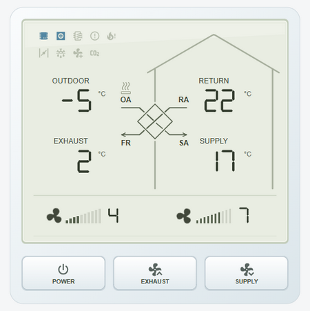
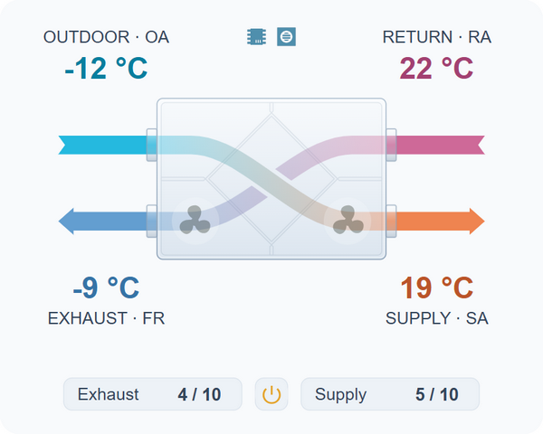

<p align="center">
  
</p>

[Русский](readme.md)

# RoyalClima · ESPHome

ESPHome firmware connecting an ESP32 to a **Royal Clima SOFFIO Primo** heat recovery ventilation unit over **Modbus RTU / RS-485**. The series includes **RCS-250-P, RCS-350-P, RCS-500-P and RCS-650-P**. Tested on **RCS-650-P**; other models and controller revisions need verification.

Potential compatibility with **Holtop XHBQ** units using the same protocol and register map: **XHBQ-D1.5DMTHA, XHBQ-D2.5DMTHA, XHBQ-D3.5DMTHA, XHBQ-D5DMTHA, XHBQ-D6.5DMTHA, XHBQ-D8DMTHA, XHBQ-D10DMTHA, XHBQ-D13DMTHA, XHBQ-D15DMTHA, XHBQ-D20DMTHA and XHBQ-D26DMTHA**. These models have not been tested.

Use the local web interface independently, connect to **Home Assistant** through the ESPHome native API, or configure MQTT. Standalone operation requires the API timeout setting below.

## Project files

- Compiled ESP32 firmware: [factory image for initial USB installation](bin/royalclima-firmware.factory.bin), [OTA update image](bin/royalclima-firmware.ota.bin).
- [ESPHome configuration](ESPHome/RoyalClima.yaml).
- Manufacturer documentation: [SOFFIO Primo manual](docs/2020_RC_Manual_Soffio-Primo.pdf), [DC (Primo) Modbus protocol](docs/Modbus%20protocol%20-%20DC%20%28Primo%29.pdf).
- Home Assistant: [package](Hass/packages/royal_clima.yaml), [dashboard examples](Hass/dashboard/), [SVG assets](Hass/images/).

## Hardware and wiring

You need an ESP32 development board, a UART-to-RS-485 transceiver with **3.3 V logic**, suitable power supplies, wiring and Wi-Fi. The configuration uses `esp32dev` with ESP-IDF.

Classic **ESP32-WROOM-32** boards such as ESP32-DevKitC or DevKit V1 are suitable when GPIO16/17/18 are available. ESP32-WROVER reserves GPIO16/17 for internal connections. Other variants, including C3 and S3, require board/GPIO adjustments and a matching build. See [ESP32-DevKitC pin restrictions](https://docs.espressif.com/projects/esp-dev-kits/en/latest/esp32/esp32-devkitc/user_guide.html).

A **3.3 V MAX3485 module** with DI, RO, DE and /RE fits the wiring below. Modules with automatic direction control require removing `uart.flow_control_pin` from your configuration. Isolated modules require wiring and power arrangements appropriate to their design. Check the complete module specification, especially the RO output voltage on 5 V modules.

| ESP32 | RS-485 module | Purpose |
|---|---|---|
| GPIO17 / TX | DI | Transmit |
| GPIO16 / RX | RO | Receive |
| GPIO18 / EN | DE and /RE joined together | High: transmit; low: receive |
| GND | Logic-side GND | UART reference |
| 3V3 | VCC of a compatible 3.3 V module | Transceiver power |

Connect module **A/B** to the unit's **A/B** terminals. Power the ESP32 through USB or its specified power input. Check terminal naming, bus reference grounding and termination against the equipment documentation; do not connect RS-485 signals directly to GPIOs.


### Power from the ventilation unit

**This power option has not been tested in practice and requires verification on the specific unit.**

An alternative is a simple, inexpensive **12 V → 5 V step-down DC-DC converter**, supplied from **+12 V and GND on the unit's RS-485 connector**. Connect its 5 V output to the ESP32 board's specified 5 V power input; a compatible 3.3 V transceiver can use the board's 3V3 output. In a non-isolated setup, the unit, converter, ESP32 and transceiver share ground.

This makes a module with no separate external power supply, connected to the unit by **four wires in one connector: +12 V, GND, A and B**. The manufacturer diagram shows these terminals but does not specify the available 12 V output current. Confirm sufficient spare capacity in both the unit's output and the DC-DC converter, allowing for ESP32 Wi-Fi current peaks and other loads. **Do not apply 12 V directly to the ESP32.** Do not power it from USB and the converter simultaneously unless the board explicitly supports this; see [ESP32-DevKitC power options](https://docs.espressif.com/projects/esp-dev-kits/en/latest/esp32/esp32-devkitc/user_guide.html#power-supply-options).

## Firmware setup

1. Copy [RoyalClima.yaml](ESPHome/RoyalClima.yaml) into your ESPHome configuration directory. The build needs support for ESP-IDF, `esphome.devices` and the components used in the file; a minimum tested ESPHome version is not specified.
2. Create `secrets.yaml` beside it:

   ```yaml
   wifi_ssid: "Primary Wi-Fi"
   wifi_password: "Primary password"
   wifi_ssid2: "Backup Wi-Fi"
   wifi_password2: "Backup password"
   ```

   Remove the second `wifi.networks` entry if only one network is needed.
3. Check GPIOs, baud rate and Modbus address in `substitutions`.
4. Validate, compile and flash:

   ```console
   esphome config RoyalClima.yaml
   esphome run RoyalClima.yaml
   ```

   Use USB initially and ESPHome OTA for subsequent updates. The supplied factory and OTA images serve different purposes and are not interchangeable.
5. Open `http://royalclima.local/` or the ESP32 IP address. If configured Wi-Fi is unavailable, a fallback access point and captive portal are enabled after 90 seconds.

The web server runs on port 80 and serves its resources locally without an external CDN. OTA uses the ESPHome OTA component.

The YAML currently enables `api:` and leaves MQTT commented out. For standalone use without a persistent native API client, set:

```yaml
api:
  reboot_timeout: 0s
```

This disables the API's default 15-minute restart timeout; a web browser connection is not a native API connection. See [ESPHome native API](https://esphome.io/components/api/).

For [MQTT](https://esphome.io/components/mqtt/), enable `mqtt` and configure broker credentials. Remove unused `api:` or disable its restart timeout. The supplied HA package and dashboards target native API entities; check entity references and connection indicators when switching to MQTT.

API encryption, OTA password and web authentication are not configured in the supplied YAML; configure them for your network.

## Language support

Minimal Russian and English support is available. `Message language` selects firmware status/error text (`ru` or `en`, default `en`). This device-wide setting persists across reboots and applies within 3 seconds.

The control panel and airflow diagram follow the Home Assistant interface language: Russian for `ru`, English for other languages. Reload the page after changing the interface language. The airflow diagram uses one YAML and one shared SVG for all states; translated labels are defined in YAML. Firmware messages and card labels use independent language settings; entity names and package settings remain shared. The examples are not fully localized. Fan steps use numbers 0–10, with 0 meaning stopped.

## Modbus behavior

| Setting | Default |
|---|---|
| Serial | 9600 baud, 8N1; SW4-4 ON = 9600, OFF = 4800 |
| Modbus address | 1; must match controller parameter 08 |
| Main polling | Every 15 s, registers 9–20 |
| Secondary polling | Every 60 s, registers 25, 27 and 769 |
| Response timeout / turnaround | 1500 ms / 600 ms |
| Command retries | 1 |
| Main / secondary stale timeout | 60 s / 180 s |

Holding registers are read using FC03: 9–20 as one block, with 25, 27 and 769 read separately. Controls write registers 9–11, 19 and 27 using FC06. No power restore command is sent on ESP32 startup.

Fan steps **0–10** map to protocol codes **0, 2, 3, 5, 8, 9, 10, 11, 12, 13, 14**. These are speed steps, not RPM or percentages. Temperatures in registers 12–15 are converted by subtracting 40.

`ESP32 connection` indicates a native API client connection. `Vent system Online` means the main register block has non-stale data. A failed command does not immediately clear Online: the last confirmed state is retained until the 60 s timeout. Before the first successful main read, Online is off. Its status is checked at intervals of up to 3 s.

Main readings become unknown after 60 s without updates; secondary readings after 180 s. Derived values follow on their next calculation. Online does not guarantee fresh secondary readings or successful command delivery. `Seconds since last data` tracks register **9**, not every response. `Offline events` counts offline transitions in both polling groups since ESP32 boot.

Logging is WARN. Standard Modbus component warnings are suppressed while ERROR messages remain; the custom retry-exhaustion warning is limited to once per minute when another failure occurs.

## Entities

The following inventory lists every sensor in the current [ESPHome YAML](ESPHome/RoyalClima.yaml), including raw registers and diagnostics.

Entity IDs assume the default device names: `Ventilation System` → `ventilation_system_*`, `Royal Clima` → `royal_clima_*`. Renaming or name conflicts in HA can change the actual IDs; check the entity registry. ESPHome text sensors use the HA `sensor` domain.

\* marks entities disabled by default in HA; enable them in the integration settings if needed. Internal register reads remain active.

### Operating measurements and setpoints

| Entity / expected entity_id | Description |
|---|---|
| Return air temperature<br>`sensor.ventilation_system_return_air_temperature` | Return air temperature RA, °C. Source: register 12. |
| Outdoor air temperature<br>`sensor.ventilation_system_outdoor_air_temperature` | Outdoor air temperature OA, °C. Source: register 13. |
| Supply Air Temperature<br>`sensor.ventilation_system_supply_air_temperature` | Supply air temperature SA, °C. Source: register 14. |
| Defrost temperature<br>`sensor.ventilation_system_defrost_temperature` | Exhaust air temperature FR, °C. Source: register 15. |
| Supply fan speed<br>`sensor.ventilation_system_supply_fan_speed` | Read-back supply step 0–10; 0 means stopped. Not RPM or a percentage. Unrecognized codes produce an unknown value. Source: register 10. |
| Exhaust fan speed<br>`sensor.ventilation_system_exhaust_fan_speed` | Read-back exhaust step 0–10; 0 means stopped. Not RPM or a percentage. Unrecognized codes produce an unknown value. Source: register 11. |
| Humidity setpoint<br>`sensor.ventilation_system_humidity_setpoint` | Read-back humidity setpoint, 1–99 %, not measured humidity. Source: register 19. |
| Heater temperature setpoint<br>`sensor.ventilation_system_heater_temperature_setpoint` | Read-back heater temperature setpoint, 10–25 °C. Source: register 27. |
| Filter reminder interval<br>`sensor.ventilation_system_filter_reminder_interval` | Configured filter reminder period in days (45/60/90/180), not time remaining until service. Source: register 25. |
| Fan runtime<br>`sensor.ventilation_system_fan_runtime` | Unit fan runtime in hours, with 0.1 h resolution. Not ESP32 uptime. Source: register 769. |

### Raw register sensors

| Entity / expected entity_id | Description |
|---|---|
| Power state raw *<br>`sensor.ventilation_system_power_state_raw` | Raw unit power: 0 off, 1 on. Source: register 9. |
| Supply fan speed code *<br>`sensor.ventilation_system_supply_fan_speed_code` | Supply fan protocol code before conversion to step 0–10. Source: register 10. |
| Exhaust fan speed code *<br>`sensor.ventilation_system_exhaust_fan_speed_code` | Exhaust fan protocol code before conversion to step 0–10. Source: register 11. |
| Status flags raw *<br>`sensor.ventilation_system_status_flags_raw` | Status bitmask: bit 0 fire input, 1 bypass open, 2 bypass closed, 3 defrost. Source: register 18. |
| Error flags raw *<br>`sensor.ventilation_system_error_flags_raw` | Raw error bitmask: 0 means no errors; multiple faults may coexist. Source: register 20. |
| External boost signal raw *<br>`sensor.ventilation_system_external_boost_signal_raw` | Raw external boost signal: 0 inactive, 1 active. Source: register 16. |
| CO2 boost signal raw *<br>`sensor.ventilation_system_co2_boost_signal_raw` | Raw CO₂ boost signal: 0 inactive, 1 active. Not CO₂ concentration. Source: register 17. |
| Filter interval code *<br>`sensor.ventilation_system_filter_interval_code` | Reminder period code: 0/1/2/3 maps to 45/60/90/180 days. Source: register 25. |

### Unit binary states

| Entity / expected entity_id | Description |
|---|---|
| Vent system Online<br>`binary_sensor.ventilation_system_vent_system_online` | Main block 9–20 has been read and has not expired. Off before the first read; after 60 s without updates it turns off at the next check (up to 3 s). Does not confirm secondary group freshness or command delivery. |
| Ventilation power<br>`binary_sensor.ventilation_system_ventilation_power` | On/off power state from the register, not proof of fan rotation. Unknown when source data expires. Source: register 9. |
| Bypass open<br>`binary_sensor.ventilation_system_bypass_open` | On means open, off means closed. Unknown if position bits are both set/both clear, or source data is missing. Source: register 18, bits 1–2. |
| Bypass closed *<br>`binary_sensor.ventilation_system_bypass_closed` | Auxiliary bypass-closed flag from bit 2; unknown without source data. Source: register 18, bit 2. |
| Defrost active<br>`binary_sensor.ventilation_system_defrost_active` | On while defrost is active, off otherwise; unknown without source data. Source: register 18, bit 3. |
| Fire alarm<br>`binary_sensor.ventilation_system_fire_alarm` | On when the unit fire input is active, off otherwise. A controller signal, not an independent smoke measurement. Source: register 18, bit 0. |
| Ventilation error<br>`binary_sensor.ventilation_system_ventilation_error` | On for a nonzero error mask, off when no faults are reported. See Error description; unknown without source data. Source: register 20. |
| External boost active<br>`binary_sensor.ventilation_system_external_boost_active` | On for an external high-speed boost request (register value 1), off otherwise. Source: register 16. |
| CO2 boost active<br>`binary_sensor.ventilation_system_co2_boost_active` | On for a CO₂ boost request (register value 1), off otherwise. Not a ppm measurement. Source: register 17. |

### Unit text states

| Entity / expected entity_id | Description |
|---|---|
| Ventilation status<br>`sensor.ventilation_system_ventilation_status` | Summary of power, open bypass, defrost, fire input and unknown flags. Message language selects ru/en; recalculated every 3 s. Source: register 9, 18. |
| Error description<br>`sensor.ventilation_system_error_description` | Register 20 error descriptions in ru/en with the original numeric code. A zero mask produces No errors; recalculated every 3 s. Source: register 20. |

### Communication and ESP32 diagnostics

| Entity / expected entity_id | Description |
|---|---|
| WiFi signal<br>`sensor.royal_clima_wifi_signal` | ESP32 Wi-Fi received signal level in dBm; updated every 60 s. |
| Uptime<br>`sensor.royal_clima_uptime` | ESP32 time since reboot in seconds; updated every 60 s. Not ventilation unit runtime. |
| Seconds since last data<br>`sensor.ventilation_system_seconds_since_last_data` | Seconds since the last successful read of register 9. Unknown before the first reply; other read groups do not reset it. |
| Offline events<br>`sensor.ventilation_system_offline_events` | Offline transitions across both Modbus polling groups since ESP32 boot. Resets at reboot; not a count of every lost packet. |
| ESP32 connection<br>`binary_sensor.royal_clima_esp32_connection` | ESP32 native API client connection, for example to HA. Not Modbus connectivity to the unit. |
| Project version<br>`sensor.royal_clima_project_version` | Installed firmware project version from ESPHOME_PROJECT_VERSION, published every 60 s. Not the ESPHome version or an update-availability check. |

### Controls and settings (not sensors)

| Entity / expected entity_id | Description |
|---|---|
| ESP32 Reboot<br>`button.royal_clima_esp32_reboot` | Restarts only the ESP32, not the ventilation controller. |
| Ventilation control<br>`switch.ventilation_system_ventilation_control` | Unit power command, register 9; Ventilation power is the read-back state. Source: register 9. |
| Message language<br>`select.royal_clima_message_language` | Text status/error language: ru/en, default en. Persists across reboots and applies within 3 s. |
| Supply speed control<br>`select.ventilation_system_supply_speed_control` | Supply step selection 0–10, register 10. Source: register 10. |
| Exhaust speed control<br>`select.ventilation_system_exhaust_speed_control` | Exhaust step selection 0–10, register 11. Source: register 11. |
| Humidity setpoint control *<br>`number.ventilation_system_humidity_setpoint_control` | Writes humidity setpoint 1–99 %, step 1, register 19. Source: register 19. |
| Heater temperature setpoint control *<br>`number.ventilation_system_heater_temperature_setpoint_control` | Writes heater setpoint 10–25 °C, step 1, register 27. Source: register 27. |

Registers 9–20 are polled every 15 s and expire after 60 s without updates. Registers 25, 27 and 769 are polled every 60 s and expire after 180 s. Derived numeric readings recalculate every 15 s; binary unit states are checked at intervals of up to 3 s. Missing source data invalidates dependent states; text sensors report no current data in the selected language.

Register 20 fault bits: 0 OA sensor, 1 EEPROM, 2 RA sensor, 3 EA sensor, 5 SA sensor, 6 supply fan, 7 exhaust fan. Other bits are not treated as separately confirmed fault types; Error description retains the original numeric code.

`sensor.royal_clima_filter_usage` and `binary_sensor.royal_clima_filter_replacement_recommended` are created by the HA package, not the current firmware. Their calculations are described below.

## Home Assistant package

Add the device through the **ESPHome integration**. Copy [royal_clima.yaml](Hass/packages/royal_clima.yaml) to `/config/packages/royal_clima.yaml` and merge this into your existing `homeassistant` section:

```yaml
homeassistant:
  packages: !include_dir_merge_named packages
```

The package already includes the outer `royal_clima` key. Check its source entity IDs, validate the HA configuration and restart HA.

Use these wrappers for control and automations:

- `switch.royal_clima_power`
- `select.royal_clima_supply_speed`
- `select.royal_clima_exhaust_speed`

They use confirmed readings and availability checks. They are not a safety interlock and do not guarantee freshness of every register group.

The package also provides:

- `sensor.royal_clima_filter_usage`: runtime hours / (configured interval days × 24) × 100, rounded to one decimal. It can exceed 100 %.
- `binary_sensor.royal_clima_filter_replacement_recommended`: on when the calculated usage reaches 100 %.

These calculations use `sensor.ventilation_system_fan_runtime` and `sensor.ventilation_system_filter_reminder_interval`; they are unavailable without valid inputs and a positive interval. They estimate interval usage, not actual filter contamination. Check whether register 769 resets when maintenance is acknowledged on your unit; the package does not track a separate filter replacement date. No scheduled, humidity-based or CO₂-based automations are included.

## Dashboard examples

| YAML | Contents | Additional resources |
|---|---|---|
| [royal-clima-panel.yaml](Hass/dashboard/royal-clima-panel.yaml) | Control panel with temperatures, fan steps and status indicators | [card-mod](https://github.com/thomasloven/lovelace-card-mod), [Config Template Card](https://github.com/iantrich/config-template-card) |
| [royal-clima-airflow.yaml](Hass/dashboard/royal-clima-airflow.yaml) | Airflow diagram with temperatures, fan steps, power control and automatic language selection | [Config Template Card](https://github.com/iantrich/config-template-card), [Mushroom](https://github.com/piitaya/lovelace-mushroom) |
| [royal-clima-vent-tab.yaml](Hass/dashboard/royal-clima-vent-tab.yaml) | Complete `sections` view with control, history and diagnostics; `path: vent` | [Mushroom](https://github.com/piitaya/lovelace-mushroom), [stack-in-card](https://github.com/custom-cards/stack-in-card), [fold-entity-row](https://github.com/thomasloven/lovelace-fold-entity-row) |

Upload these files to `/config/www/images/`:

| Card | SVG files |
|---|---|
| Control panel | `royal-clima-panel.svg`, `royal-clima-panel-fan.svg` |
| Airflow diagram | `royal-clima-airflow.svg`, `royal-clima-fan.svg` |

Both cards together need four SVG files. Each card uses one YAML for Russian and English; separate language files and state-specific SVGs are not needed. Labels are defined in YAML and follow the HA interface language.

1. Install the HA package and the additional resources required by your example. The control panel and airflow diagram need Config Template Card with `/hacsfiles/config-template-card/config-template-card.js` registered as a **JavaScript module** resource.
2. Copy the SVG files listed above for your chosen cards from [Hass/images](Hass/images/) to **`/config/www/images/`**, keeping their names. The root `images/` directory contains README illustrations and is not needed by the cards.
3. Card URLs already use `/local/images/filename.svg`, which maps to `/config/www/images/filename.svg`. If you create `www` for the first time, restart HA. See [HA static file hosting](https://www.home-assistant.io/integrations/http/#hosting-files).
4. To install either standalone card, edit your dashboard, choose **Add card → Manual**, paste the complete card YAML, check entity IDs and save. For the complete view, paste its YAML into the **view configuration editor**, not a single-card editor.
5. Refresh the browser after updating SVG or YAML; clear its cache if older assets remain visible.

The airflow diagram only needs `royal-clima-airflow.svg` and `royal-clima-fan.svg`. URL fragments select the shared diagram state; translated labels are rendered over it from YAML.

Fan animation represents power on and a nonzero step, not measured RPM or airflow. Arrows show flow direction. Temperature history requires Recorder. The full view hides control and temperatures when the relevant connections are lost and keeps a confirmation prompt for ESP32 restart. Replace or remove its installation-specific badges `binary_sensor.mega1_port2` and `switch.mega1_port9`.

**Control panel**



**Airflow: running**


