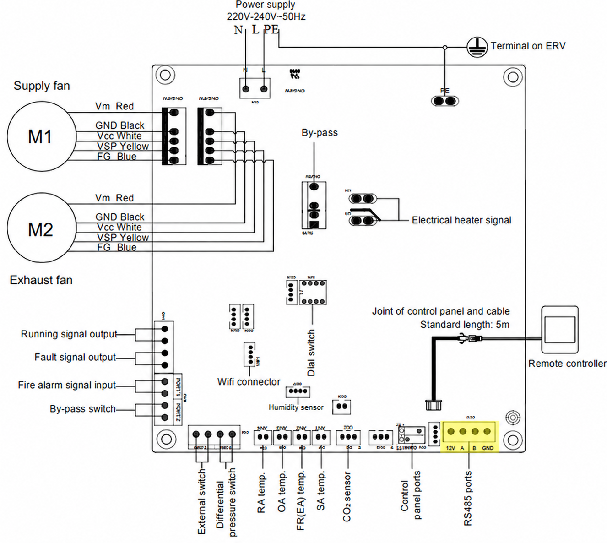
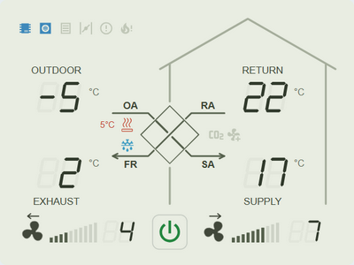
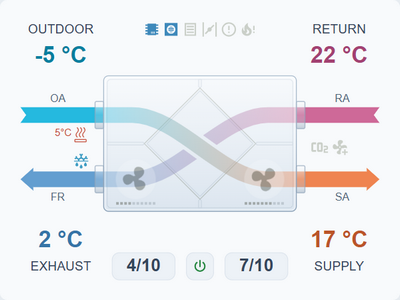

# ESPHome for Royal Clima

[](https://esphome.io/)  [](https://github.com/alidonet/ESPHome-RoyalClima/releases)

[Русский](README.ru.md)

Firmware for connecting a **Royal Clima SOFFIO Primo** heat recovery ventilation unit to an ESP32. Control ventilation and view readings through Home Assistant or a web browser.

<p align="center">
   
  &nbsp; 
</p>

The series includes **RCS-250-P, RCS-350-P, RCS-500-P and RCS-650-P**. Tested on **RCS-650-P**. Compatibility with **Holtop XHBQ** units is possible but has not been tested.

- [Firmware for initial USB installation](bin/royalclima-firmware.factory.bin).
- [Firmware for Wi-Fi updates](bin/royalclima-firmware.ota.bin).
- [ESPHome configuration](RoyalClima.yaml).
- [Manufacturer documentation](docs/).

<p align="center">
  
</p>

## What you need

- An **ESP32-WROOM-32** board, such as ESP32-DevKitC or DevKit V1.
- A **UART ↔ RS-485 transceiver with 3.3 V logic**, such as a MAX3485 module with DI, RO, DE and /RE pins.
- A USB data cable, an ESP32 power supply and connecting wires.
- A Wi-Fi network.

ESP32-C3, S3 and boards with different pins require corresponding configuration changes. The wiring below is for a standard ESP32-WROOM-32 board.

## Wiring

Disconnect the ventilation unit from power before connecting wires.

```text
+--------------------+        +------------------------+        +--------------------+
|  Ventilation unit  |        |    UART <-> RS-485     |        |       ESP32        |
|                GND | [1]    |                        |        |                    |
|    RS-485 port   B |<------>| B                   DI |<-------| GPIO17 / TX        |
|                  A |<------>| A                   RO |------->| GPIO16 / RX        |
|                12V | [1]    |               DE + /RE |<-------| GPIO18 / EN        |
|                    |        |                    GND |--------| GND                |
|                    |        |                    VCC |<-------| 3V3 [2]            |
+--------------------+        +------------------------+        |                    |
                                                                | USB / power        |
                                                                +--------------------+
```

[1] +12 V and GND on the unit's connector are for the DC-DC power option described below.

[2] 3.3 V power for a compatible MAX3485 module.

| ESP32 | RS-485 transceiver |
|---|---|
| GPIO17 | DI |
| GPIO16 | RO |
| GPIO18 | DE and /RE connected together |
| GND | GND |
| 3V3 | VCC of a 3.3 V module |

Connect transceiver terminals **A and B** to **A and B** on the unit's RS-485 connector. Power the ESP32 through USB or the board's designated power input. Check the transceiver's pin labels.



Set **SW4-4 to ON for 9600 baud** on the ventilation unit's board. The default unit address is **1** (parameter 08 on the wired controller). The adapter defaults to 9600 baud; set `baud_rate` to `"4800"` for SW4-4 OFF and rebuild. If you change the unit address, set the same `modbus_address` substitution and rebuild the firmware. Both polling groups use that address.

### Power from the ventilation unit

One option is an inexpensive **12 V → 5 V step-down DC-DC converter** connected to **+12 V and GND** on the same RS-485 connector. Feed its 5 V output into an ESP32 input rated for 5 V. This connects the module to the unit using four wires: **+12 V, GND, A and B**.

**This option has not been tested in practice.** Check the permissible load of the 12 V output and whether it can supply enough power for the ESP32 and transceiver. Do not apply 12 V directly to the ESP32. Do not connect USB and DC-DC power simultaneously unless the board supports it.

## Installing the firmware

### Prebuilt firmware

1. Connect the ESP32 to your computer using USB.
2. Open [ESPHome Web](https://web.esphome.io/) in Chrome or Edge, connect to the board and install the **factory.bin** file linked above.
3. If the installer offers Wi-Fi setup over USB (Improv Serial), enter your network details. Otherwise, connect your phone or computer to the open **royalclima Setup** network and open `http://192.168.4.1/`: select your 2.4 GHz Wi-Fi network and enter its password.
4. Open `http://royalclima.local/` or the ESP32's IP address. Configure the MQTT fields if needed and press **MQTT apply**.

For subsequent Wi-Fi updates, upload **ota.bin** through the device web interface. No ESPHome build is needed to change connection settings.

### MQTT setup in the standard web interface

After Wi-Fi provisioning, open the ESP32's IP address or `http://royalclima.local/`. MQTT uses ordinary ESPHome configuration entities on the same page; there is no separate setup page or external component. Home Assistant API remains available independently of MQTT.

MQTT configuration entities are disabled by default in Home Assistant and remain available in the device web interface. Home Assistant keeps the enabled/disabled choice for entities already registered; manage that choice in HA.

| Entity | Purpose |
|---|---|
| MQTT enabled | Enable MQTT for the next startup; off by default. |
| MQTT broker | Broker hostname or IP, without a URI scheme, path or spaces. |
| MQTT port | Integer 1–65535; default 1883. Plain MQTT/TCP; TLS is not configured by these fields. |
| MQTT username | Optional broker username, up to 128 UTF-8 bytes. |
| MQTT password | Write-only password input, up to 128 bytes. It clears after entry; blank input keeps the existing password. The secret is stored separately and is never returned as entity state. |
| MQTT clear password | Clear the saved password; apply to reconnect. |
| MQTT topic | Up to 64 bytes; no spaces, `+`, `#` or leading/trailing `/`. A blank saved value selects `royalclima_<last six MAC digits>` at startup. |
| MQTT apply | Validate, flush saved settings and restart only the ESP32. New connection settings apply after restart. |
| MQTT setup status | Validation errors or setup status; credentials are not included. |

Enter each field and submit it using the normal ESPHome control, then press **MQTT apply**. Fields are saved as they change; the password is saved by a restoring internal global. Normal OTA preserves these settings; flash erase or factory reset clears them. A reboot also applies the most recently saved fields. A broker is required only when MQTT is enabled. API and MQTT do not cause reboots when no client/broker is connected.

RS485 defaults to **9600 baud**, configured at build time through `baud_rate` (`"9600"` or `"4800"`). The Modbus address is a compile-time substitution (`modbus_address`, default 1), not a web setting. These values must match the ventilation unit. Use the web interface on a trusted local network: it uses HTTP, and stored credentials are not encrypted by this YAML configuration.

### Installation through ESPHome

1. Add [RoyalClima.yaml](RoyalClima.yaml) to ESPHome Device Builder; no external components are required.
2. Adjust `tx_pin`, `rx_pin`, `en_pin`, `baud_rate` and `modbus_address` for your installation.
3. Select **Install**. Use USB for the first installation and Wi-Fi for subsequent updates. Configure Wi-Fi after flashing, through USB or **royalclima Setup**, as described above; Wi-Fi does not require `secrets.yaml`.

Wi-Fi credentials are stored on the ESP32. Normal OTA updates preserve them as long as the YAML does not specify an SSID and password. Erasing flash or performing a factory reset clears the settings; USB flashing that erases flash requires provisioning again. If the saved network is unavailable, the device returns to setup mode (fallback AP timeout: 30 seconds). See [ESPHome Wi-Fi credential persistence](https://esphome.io/components/wifi/#saving-wifi-credentials).

Requires **ESPHome 2026.11.0 or newer**. The ventilation unit is declared as a separate Modbus device with `relation: via`.

## Features

- Turn ventilation on and off.
- Set supply and exhaust fan speeds independently: **steps 0–10**, where 0 means stopped.
- Four temperatures: outdoor air, return air from the room, supply air and exhaust air discharged outside.
- Bypass, defrost, fire input and boost states.
- Fan runtime and the configured filter reminder interval.
- Read and change humidity and heater temperature setpoints.
- Text status and error messages in Russian or English, selected through **Language**.

Sensor boost depends on the unit's settings: **CO₂ or humidity**. Separate external boost is activated by closing the External switch input on the ventilation unit's board.

## Sensors and their purpose

Names below match the firmware. One ESPHome node exposes two HA devices: **Vent** (the ventilation unit, `vent_` prefix) and **RoyalClima** (ESP32, `royalclima_` prefix). In HA you can rename their display names to **ERV** and **ESP** while keeping entity IDs unchanged. Entity names themselves do not repeat the device name.

Example target IDs: `sensor.vent_supply_temp`, `select.vent_supply_speed`, `switch.vent_power`, `sensor.royalclima_version`, `button.royalclima_reboot`.

### Ventilation readings

| Name | Target HA ID | Purpose |
|---|---|---|
| Return temp | `sensor.vent_return_temp` | Temperature of air extracted from the room (RA). |
| Outdoor temp | `sensor.vent_outdoor_temp` | Outdoor air temperature (OA). |
| Supply temp | `sensor.vent_supply_temp` | Temperature of air supplied to the room (SA). |
| Exhaust temp | `sensor.vent_exhaust_temp` | Temperature of air discharged outside (FR). |
| Filter interval | `sensor.vent_filter_interval` | Configured filter reminder period in days, not days remaining. |
| Runtime | `sensor.vent_runtime` | Fan runtime in hours. |
| Filter usage | `sensor.vent_filter_usage` | Runtime as a percentage of the configured filter interval: hours / (days × 24) × 100. Can exceed 100%; unknown until the source data is first received. |

Slow registers 25, 27 and 769 are polled every 5 minutes. The last received filter interval, heater setpoint and runtime are retained across missed replies until the ESP32 restarts. They are unknown until their first successful read. Filter interval and Filter usage are recalculated when source data arrives. Main unit readings expire after 60 seconds without a reply.

Speeds are steps, not RPM or percentages. Humidity is a setpoint, not a measurement. The filter interval is a configured period, not time remaining until maintenance.

### Ventilation states

| Name | Target HA ID | Purpose |
|---|---|---|
| Online | `binary_sensor.vent_online` | Up-to-date data is available from the ventilation unit. |
| Bypass open | `binary_sensor.vent_bypass_open` | The bypass is open or closed. |
| Bypass closed * | `binary_sensor.vent_bypass_closed` | An additional bypass-closed indicator. |
| Defrost | `binary_sensor.vent_defrost` | Defrost mode is active. |
| Fire alarm | `binary_sensor.vent_fire_alarm` | The unit's fire input is active. |
| Fault | `binary_sensor.vent_fault` | The unit reports an error. |
| External boost | `binary_sensor.vent_external_boost` | Boost from the external input is active. |
| Sensor boost | `binary_sensor.vent_sensor_boost` | Boost from the CO₂ or humidity sensor is active, depending on the unit's settings. |
| Status | `sensor.vent_status` | Text description of the unit's status in the selected language. |
| Fault details | `sensor.vent_fault_details` | Description of the unit's errors in the selected language. |

### ESP32 and communication diagnostics

| Name | Target HA ID | Purpose |
|---|---|---|
| WiFi signal | `sensor.royalclima_wifi_signal` | ESP32 Wi-Fi signal level. |
| Uptime | `sensor.royalclima_uptime` | ESP32 time since reboot, in seconds. |
| API connected | `binary_sensor.royalclima_api_connected` | The ESP32 is connected to Home Assistant or another ESPHome client. |
| Version | `sensor.royalclima_version` | Installed project firmware version. |
| Data age | `sensor.vent_data_age` | Seconds since the last successful read of the unit's main data. |
| Offline count | `sensor.vent_offline_count` | Number of communication failures since ESP32 startup. |

### Additional diagnostic sensors

Power raw, Supply code, Exhaust code, Status bits, External boost raw, Sensor boost raw and Filter code are firmware-only (`internal: true`) and are not HA entities. Fault bits is exported but disabled by default. An asterisk (*) in the tables marks exported entities disabled by default; enable them in the ESPHome integration settings when needed.

| Name | Target HA ID | Purpose |
|---|---|---|
| Power raw | — (`internal`) | Raw unit power state. |
| Supply code | — (`internal`) | Raw supply fan speed code. |
| Exhaust code | — (`internal`) | Raw exhaust fan speed code. |
| Status bits | — (`internal`) | Raw unit status flags. |
| Fault bits * | `sensor.vent_fault_bits` | Raw unit error code. |
| External boost raw | — (`internal`) | Raw boost signal from the external input. |
| Sensor boost raw | — (`internal`) | Raw boost signal from the CO₂ or humidity sensor. |
| Filter code | — (`internal`) | Raw code for the configured filter reminder period. |

Power, fan steps and setpoints use one public control entity each (`switch`, `select`, `number`). Their state follows unit reads; writes do not optimistically confirm the requested value. Setpoints and Fault bits are disabled by default in HA. Internal read/write helpers are not exported.

### Controls and settings

| Name | Target HA ID | Purpose |
|---|---|---|
| Power | `switch.vent_power` | Turn the unit on and off. |
| Supply speed | `select.vent_supply_speed` | Select the supply fan step: 0–10. |
| Exhaust speed | `select.vent_exhaust_speed` | Select the exhaust fan step: 0–10. |
| Humidity target * | `number.vent_humidity_target` | Change the humidity setpoint: 1–99 %. |
| Heater target * | `number.vent_heater_target` | Change the heater temperature setpoint: 10–25 °C. |
| Language | `select.royalclima_language` | Message language: ru for Russian, en for English. Defaults to en; the selection is saved. |
| Reboot | `button.royalclima_reboot` | Restart only the ESP32, without restarting the ventilation controller. |

## Connecting to Home Assistant

In Home Assistant, open **Settings → Devices & services** and add the discovered ESPHome device. If it is not discovered automatically, add the **ESPHome** integration and enter the ESP32's IP address.

For convenient control, use the separate [Royal Clima ERV Card](https://github.com/alidonet/ha-royal-clima-card) project. Installation and configuration instructions are available in its repository.
Example card views in Home Assistant (Russian labels):

 


Readings and controls are also available in a browser at the ESP32's address. MQTT is configured using the standard ESPHome configuration entities in the web interface.

## Project status

ESPHome-RoyalClima is an independent, unofficial ESPHome firmware project for compatible Royal Clima ventilation units.

The Royal Clima logo shown above identifies the equipment manufacturer. Rights to the logo belong to its respective owner.
