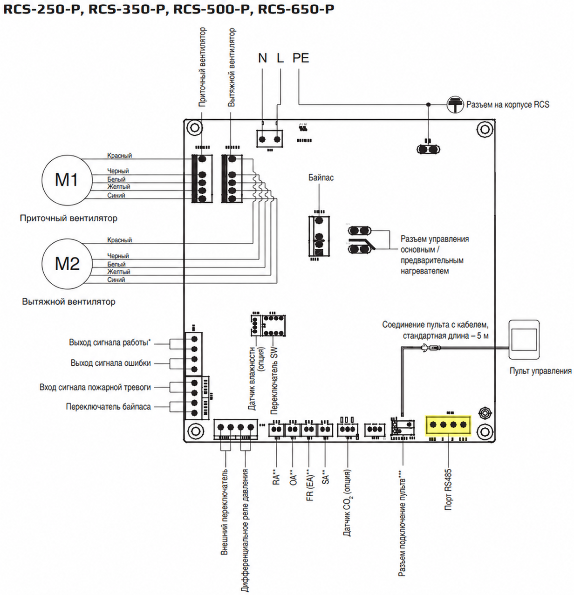
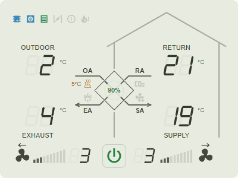
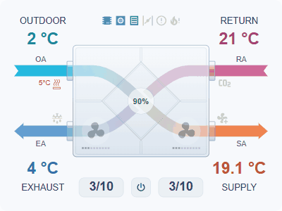

# ESPHome для Royal Clima

[](https://esphome.io/)  [](https://github.com/alidonet/ESPHome-RoyalClima/releases)

[English](README.md)

Прошивка для подключения рекуператора **Royal Clima SOFFIO Primo** к ESP32. Позволяет управлять вентиляцией и получать показания через Home Assistant или браузер.

<p align="center">
   
  &nbsp; 
</p>

Серия включает **RCS-250-P, RCS-350-P, RCS-500-P и RCS-650-P**. Работа проверена на **RCS-650-P**. Возможна совместимость с **Holtop XHBQ**, но она не проверена.

- [Прошивка для первой установки через USB](bin/royalclima-firmware.factory.bin).
- [Прошивка для обновления по Wi-Fi](bin/royalclima-firmware.ota.bin).
- [Конфигурация ESPHome](RoyalClima.yaml).
- [Документация производителя](docs/).

<p align="center">
  
</p>

## Что потребуется

- Плата **ESP32-WROOM-32**, например ESP32-DevKitC или DevKit V1.
- Преобразователь **UART ↔ RS-485 с логикой 3,3 В**, например модуль на MAX3485 с контактами DI, RO, DE и /RE.
- USB-кабель с передачей данных, питание для ESP32 и провода подключения.
- Сеть Wi-Fi.

Для ESP32-C3, S3 и плат с другими выводами нужна соответствующая настройка конфигурации. Подключение ниже рассчитано на обычную плату ESP32-WROOM-32.

## Подключение

Подключайте провода при отключённом питании ПВУ.

```text
+--------------------+        +------------------------+        +--------------------+
|    Рекуператор     |        |    UART <-> RS-485     |        |       ESP32        |
|                GND | [1]    |                        |        |                    |
|    Порт RS-485   B |<------>| B                   DI |<-------| GPIO17 / TX        |
|                  A |<------>| A                   RO |------->| GPIO16 / RX        |
|                12V | [1]    |               DE + /RE |<-------| GPIO18 / EN        |
|                    |        |                    GND |--------| GND                |
|                    |        |                    VCC |<-------| 3V3 [2]            |
+--------------------+        +------------------------+        |                    |
                                                                | USB / питание      |
                                                                +--------------------+
```

[1] +12 В и GND на разъёме ПВУ — для варианта питания через DC-DC, описанного ниже.

[2] Питание 3,3 В для совместимого модуля MAX3485.

| ESP32 | Преобразователь RS-485 |
|---|---|
| GPIO17 | DI |
| GPIO16 | RO |
| GPIO18 | DE и /RE, соединённые вместе |
| GND | GND |
| 3V3 | VCC модуля на 3,3 В |

Контакты **A и B** преобразователя соедините с **A и B** разъёма RS-485 рекуператора. ESP32 питается через USB или предусмотренный вход питания платы. Названия контактов преобразователя сверяйте с его маркировкой.



На плате рекуператора установите **SW4-4 в положение ON — скорость 9600 бод**. Адрес установки по умолчанию — **1** (параметр 08 штатного пульта). Скорость адаптера по умолчанию — 9600 бод; для SW4-4 OFF задайте `baud_rate: "4800"` и пересоберите прошивку. При изменении адреса ПВУ задайте такой же `modbus_address` в подстановках YAML и пересоберите прошивку. Обе группы опроса используют этот адрес.

### Питание от рекуператора

В качестве варианта можно использовать недорогой понижающий **DC-DC 12 → 5 В**, подключив его к контактам **+12 В и GND** того же разъёма RS-485. Выход 5 В подаётся на вход питания ESP32, рассчитанный на 5 В. Модуль подключается к ПВУ четырьмя проводами: **+12 В, GND, A и B**.

**Этот вариант на практике не проверялся.** Нужно проверить допустимую нагрузку выхода 12 В и достаточность питания для ESP32 и преобразователя. Не подавайте 12 В напрямую на ESP32. Не подключайте одновременно USB и питание от DC-DC, если плата не допускает такой режим.

## Установка прошивки

### Готовая прошивка

1. Подключите ESP32 к компьютеру через USB.
2. Откройте [ESPHome Web](https://web.esphome.io/) в Chrome или Edge, подключитесь к плате и установите файл **factory.bin** по ссылке выше.
3. Если установщик предлагает настройку Wi-Fi по USB (Improv Serial), укажите свою сеть. Иначе подключитесь телефоном или компьютером к открытой сети **royalclima Setup** и откройте `http://192.168.4.1/`: выберите свою сеть 2,4 ГГц и введите пароль.
4. Откройте `http://royalclima.local/` или IP-адрес ESP32. При необходимости заполните поля MQTT и нажмите **MQTT apply**.

Для последующих обновлений по Wi-Fi загрузите **ota.bin** через веб-интерфейс устройства. Для изменения настроек подключения сборка ESPHome не нужна.

### Настройка MQTT в штатном веб-интерфейсе

После подключения Wi-Fi откройте IP-адрес ESP32 или `http://royalclima.local/`. Для MQTT используются обычные настроечные сущности ESPHome на той же странице; отдельной страницы настройки и внешних компонентов нет. Home Assistant API доступен независимо от MQTT.

Настроечные сущности MQTT отключены по умолчанию в Home Assistant и доступны в веб-интерфейсе устройства. Для уже зарегистрированных сущностей HA сохраняет выбранное состояние активности; оно управляется в HA.

| Сущность | Назначение |
|---|---|
| MQTT enabled | Включить MQTT при следующем запуске; по умолчанию выключен. |
| MQTT broker | Имя или IP брокера без схемы URI, пути и пробелов. |
| MQTT port | Целое число 1–65535; по умолчанию 1883. Обычный MQTT/TCP; TLS через эти поля не настраивается. |
| MQTT username | Необязательный логин брокера, до 128 байт UTF-8. |
| MQTT password | Поле только для ввода пароля, до 128 байт. Очищается после ввода; пустая строка сохраняет прежний пароль. Секрет хранится отдельно и не возвращается как состояние сущности. |
| MQTT clear password | Удалить сохранённый пароль; для переподключения примените настройки. |
| MQTT topic | До 64 байт; без пробелов, `+`, `#` и `/` в начале или конце. Пустое сохранённое значение выбирает при запуске `royalclima_<последние шесть цифр MAC>`. |
| MQTT apply | Проверить настройки, записать сохранённые значения во flash и перезагрузить только ESP32. Новые параметры подключения применяются после перезагрузки. |
| MQTT setup status | Ошибки проверки или статус настройки; без учётных данных. |

Введите и отправьте каждое поле штатным элементом ESPHome, затем нажмите **MQTT apply**. Поля сохраняются по мере изменения; пароль сохраняется восстанавливаемой внутренней global. Обычное OTA сохраняет настройки; стирание flash или заводской сброс удаляет их. При перезагрузке также применяются последние сохранённые поля. Брокер обязателен только при включённом MQTT. Отсутствие клиента API или подключения к брокеру не вызывает перезагрузку.

Скорость RS485 по умолчанию — **9600 бод**; при сборке она задаётся подстановкой `baud_rate` (`"9600"` или `"4800"`). Адрес Modbus задаётся при сборке подстановкой `modbus_address` (по умолчанию 1), а не через веб-интерфейс. Эти значения должны соответствовать ПВУ. Используйте веб-интерфейс в доверенной локальной сети: он работает по HTTP, сохранённые учётные данные эта YAML-конфигурация не шифрует.

### Установка через ESPHome

1. Добавьте [RoyalClima.yaml](RoyalClima.yaml) в ESPHome Device Builder; внешние компоненты не требуются.
2. Задайте `tx_pin`, `rx_pin`, `en_pin`, `baud_rate` и `modbus_address` согласно установке.
3. Выберите «Установить». Первую установку выполните через USB, последующие — по Wi-Fi. Сеть задаётся после прошивки по USB или через **royalclima Setup**, как описано выше; `secrets.yaml` для Wi-Fi не нужен.

Wi-Fi-настройки хранятся на ESP32. Обычное OTA сохраняет их, пока в YAML не заданы SSID и пароль. Полное стирание flash или заводской сброс удаляют настройки; при USB-прошивке со стиранием потребуется повторный ввод. При недоступности сохранённой сети устройство возвращается в режим настройки (тайм-аут резервной точки — 30 секунд). См. [сохранение настроек Wi-Fi в ESPHome](https://esphome.io/components/wifi/#saving-wifi-credentials).

Требуется **ESPHome 2026.11.0 или новее**. ПВУ объявлена отдельным Modbus-устройством с `relation: via`.

## Возможности

- Включение и выключение вентиляции.
- Раздельный выбор скорости притока и вытяжки: **ступени 0–3 или 0–10**, выбираемые через **Fan speeds**; 0 — остановка.
- Четыре температуры: наружный воздух, воздух из помещения, приток и выброс воздуха.
- Состояния байпаса, разморозки, пожарного входа и форсирования.
- Наработка вентилятора и настроенный интервал напоминания о фильтре.
- Чтение и изменение заданной влажности и температуры нагревателя.
- Текстовые статусы и ошибки на русском или английском языке; выбор через **Language**.

Форсирование по датчику зависит от настроек самой ПВУ: **CO₂ или влажность**. Отдельное внешнее форсирование включается замыканием входа «Внешний переключатель» на плате ПВУ.

## Сенсоры и их назначение

Названия приведены так, как они указаны в прошивке. Один узел ESPHome предоставляет два устройства HA: **Vent** (ПВУ, префикс `vent_`) и **RoyalClima** (ESP32, префикс `royalclima_`). В HA их можно переименовать для отображения в **ERV** и **ESP**, сохранив идентификаторы сущностей. Короткие названия сущностей не содержат повторения имени устройства.

Примеры целевых ID: `sensor.vent_supply_temp`, `select.vent_supply_speed`, `switch.vent_power`, `sensor.royalclima_version`, `button.royalclima_reboot`.

### Показания установки

| Название | Целевой ID в HA | Назначение |
|---|---|---|
| Return temp | `sensor.vent_return_temp` | Температура воздуха, забираемого из помещения (RA). |
| Outdoor temp | `sensor.vent_outdoor_temp` | Температура наружного воздуха (OA). |
| Supply temp | `sensor.vent_supply_temp` | Температура воздуха, подаваемого в помещение (SA). |
| Exhaust temp | `sensor.vent_exhaust_temp` | Температура выбрасываемого воздуха (FR). |
| Filter interval | `sensor.vent_filter_interval` | Настроенный период напоминания о фильтре в днях, а не оставшиеся дни. |
| Runtime | `sensor.vent_runtime` | Наработка вентилятора в часах. |
| Filter usage | `sensor.vent_filter_usage` | Наработка в процентах от настроенного интервала фильтра: часы / (дни × 24) × 100. Может превышать 100%; до первого получения исходных данных — неизвестно. |

Медленные регистры 25, 27 и 769 опрашиваются раз в 5 минут. Последние полученные значения интервала фильтра, уставки нагревателя и наработки сохраняются при пропущенных ответах до перезагрузки ESP32. До первого успешного чтения они неизвестны. Filter interval и Filter usage пересчитываются при получении исходных данных. Основные данные ПВУ теряют актуальность через 60 секунд без ответа.

Скорости — это ступени, а не обороты или проценты. Влажность — заданное значение, а не измерение. Интервал фильтра — настроенный период, а не оставшиеся дни до обслуживания.

### Состояния установки

| Название | Целевой ID в HA | Назначение |
|---|---|---|
| Online | `binary_sensor.vent_online` | Есть актуальные данные от вентиляционной установки. |
| Bypass open | `binary_sensor.vent_bypass_open` | Байпас открыт или закрыт. |
| Bypass closed * | `binary_sensor.vent_bypass_closed` | Дополнительный признак закрытого байпаса. |
| Defrost | `binary_sensor.vent_defrost` | Активен режим разморозки. |
| Fire alarm | `binary_sensor.vent_fire_alarm` | Активен пожарный вход установки. |
| Fault | `binary_sensor.vent_fault` | Установка сообщает об ошибке. |
| External boost | `binary_sensor.vent_external_boost` | Активно форсирование по внешнему входу. |
| Sensor boost | `binary_sensor.vent_sensor_boost` | Активно форсирование по датчику CO₂ или влажности, в зависимости от настроек ПВУ. |
| Status | `sensor.vent_status` | Текстовое описание состояния установки на выбранном языке. |
| Fault details | `sensor.vent_fault_details` | Описание ошибок установки на выбранном языке. |

### Диагностика ESP32 и связи

| Название | Целевой ID в HA | Назначение |
|---|---|---|
| WiFi signal | `sensor.royalclima_wifi_signal` | Уровень сигнала Wi-Fi ESP32. |
| Uptime | `sensor.royalclima_uptime` | Время работы ESP32 после перезагрузки, в секундах. |
| API connected | `binary_sensor.royalclima_api_connected` | ESP32 подключён к Home Assistant или другому клиенту ESPHome. |
| Version | `sensor.royalclima_version` | Версия установленной прошивки проекта. |
| Data age | `sensor.vent_data_age` | Сколько секунд прошло с последнего успешного получения основных данных ПВУ. |
| Offline count | `sensor.vent_offline_count` | Количество сбоев связи после запуска ESP32. |

### Дополнительные служебные сенсоры

Power raw, Supply code, Exhaust code, Status bits, External boost raw, Sensor boost raw и Filter code используются только внутри прошивки (`internal: true`) и не доступны как сущности HA. Fault bits экспортируется, но отключён по умолчанию. Звёздочкой (*) в таблицах отмечены экспортируемые сущности, отключённые по умолчанию; их можно включить в настройках интеграции ESPHome.

| Название | Целевой ID в HA | Назначение |
|---|---|---|
| Power raw | — (`internal`) | Служебное значение состояния питания установки. |
| Supply code | — (`internal`) | Служебный код скорости приточного вентилятора. |
| Exhaust code | — (`internal`) | Служебный код скорости вытяжного вентилятора. |
| Status bits | — (`internal`) | Служебное значение состояний установки. |
| Fault bits * | `sensor.vent_fault_bits` | Служебный код ошибок установки. |
| External boost raw | — (`internal`) | Служебный сигнал форсирования по внешнему входу. |
| Sensor boost raw | — (`internal`) | Служебный сигнал форсирования по датчику CO₂ или влажности. |
| Filter code | — (`internal`) | Служебный код настроенного периода напоминания о фильтре. |

Питание, ступени вентиляторов и уставки представлены одной публичной сущностью управления на параметр (`switch`, `select`, `number`). Состояние обновляется по чтению ПВУ; запись не подтверждает запрошенное значение заранее. Уставки и Fault bits отключены по умолчанию в HA. Внутренние источники чтения и исполнители записи не экспортируются.

В веб-интерфейсе устройства выберите **Fan speeds** = **3** или **10** (по умолчанию 10). Выбор сохраняется и автоматически перезагружает ESP32, чтобы обновить списки скоростей в HA, MQTT и веб-интерфейсе. В обоих режимах доступен 0. Настройка не меняет параметры двигателей ПВУ и не отправляет команду скорости. Для ступеней 1, 2 и 3 используются коды 2, 3 и 5. Совместимость с AC-установками на оборудовании не проверена; остальные регистры и расшифровка ошибок остаются по протоколу DC.

### Управление и настройки

| Название | Целевой ID в HA | Назначение |
|---|---|---|
| Power | `switch.vent_power` | Включение и выключение установки. |
| Supply speed | `select.vent_supply_speed` | Выбор ступени приточного вентилятора: 0–3 или 0–10 согласно **Fan speeds**. |
| Exhaust speed | `select.vent_exhaust_speed` | Выбор ступени вытяжного вентилятора: 0–3 или 0–10 согласно **Fan speeds**. |
| Humidity target * | `number.vent_humidity_target` | Изменение заданной влажности: 1–99 %. |
| Heater target * | `number.vent_heater_target` | Изменение заданной температуры нагревателя: 10–25 °C. |
| Fan speeds * | `select.vent_fan_speeds` | Выбор 3 или 10 ступеней; сохраняется, автоматически перезагружает ESP32. Доступен в веб-интерфейсе, отключён по умолчанию в HA. |
| Language | `select.royalclima_language` | Язык сообщений: ru — русский, en — английский. По умолчанию en; выбор сохраняется. |
| Reboot | `button.royalclima_reboot` | Перезагрузка только ESP32, без перезапуска контроллера ПВУ. |

## Подключение к Home Assistant

В Home Assistant откройте **Настройки → Устройства и службы** и добавьте обнаруженное устройство ESPHome. Если оно не найдено автоматически, добавьте интеграцию **ESPHome** и укажите IP-адрес ESP32.

Для удобного управления используйте отдельный проект [Royal Clima ERV Card](https://github.com/alidonet/ha-royal-clima-card). Установка и настройка карточки описаны в её репозитории.
Примеры отображения карточки в Home Assistant:




Показания и управление также доступны в браузере по адресу ESP32. MQTT настраивается штатными настроечными сущностями ESPHome в веб-интерфейсе.

## Статус проекта

ESPHome-RoyalClima — независимый неофициальный проект прошивки ESPHome для совместимых вентиляционных установок Royal Clima.

Логотип Royal Clima выше обозначает производителя оборудования. Права на логотип принадлежат его правообладателю.
