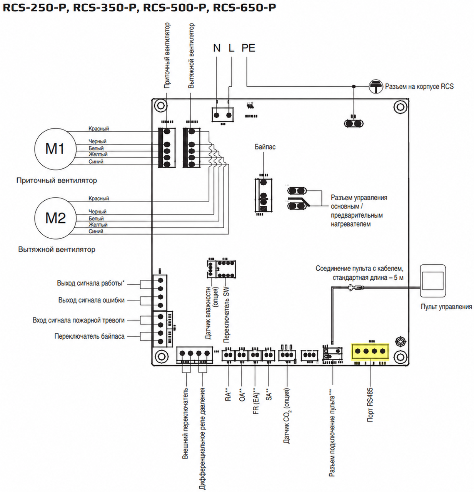

<p align="center">
  
  
  
</p>

[English](README.en.md)

Прошивка на базе ESPHome для связи ESP32 с приточно-вытяжной установкой Royal Clima серии **SOFFIO Primo** по Modbus RTU через RS-485. В руководстве серии перечислены модели **RCS-250-P, RCS-350-P, RCS-500-P и RCS-650-P**. Работа проекта проверена на **RCS-650-P**; совместимость с другими моделями и ревизиями контроллера требует проверки.

Возможна совместимость с установками **Holtop**: **XHBQ-D1.5DMTHA, XHBQ-D2.5DMTHA, XHBQ-D3.5DMTHA, XHBQ-D5DMTHA, XHBQ-D6.5DMTHA, XHBQ-D8DMTHA, XHBQ-D10DMTHA, XHBQ-D13DMTHA, XHBQ-D15DMTHA, XHBQ-D20DMTHA и XHBQ-D26DMTHA** — при совпадении протокола Modbus и карты регистров. Работа прошивки с этими моделями не проверена; совместимость требует подтверждения для конкретной модели и ревизии контроллера.

ESP32 позволяет получать показания и управлять установкой через локальный веб-интерфейс, а также подключать её к умному дому на базе **Home Assistant** через native API ESPHome. Также возможна работа через MQTT после настройки компонента `mqtt` и подключения к брокеру. Для самостоятельной работы без клиента API нужна настройка, описанная ниже.

В данном проекте вы найдете:

- Скомпилированные прошивки для ESP32: [firmware для первоначальной установки](bin/royalclima-firmware.factory.bin) и [OTA для обновления](bin/royalclima-firmware.ota.bin).
- [Конфигурацию для ESPHome](RoyalClima.yaml).
- [Документацию](docs/): [руководство SOFFIO Primo](docs/2020_RC_Manual_Soffio-Primo.pdf) и [протокол Modbus DC (Primo)](docs/Modbus%20protocol%20-%20DC%20%28Primo%29.pdf).

<p align="center">
  
</p>


## Что потребуется

| Компонент | Назначение и требования |
|---|---|
| ESP32 | Плата разработки, совместимая с конфигурацией `esp32dev`. Прошивка использует ESP-IDF |
| Преобразователь UART ↔ RS-485 | Логические уровни на стороне ESP32 — 3,3 В. Текущая схема предполагает управление направлением через объединённые DE и /RE |
| Источник питания | Для ESP32 и преобразователя, с напряжениями по спецификации выбранных плат |

### Варианты плат

Для текущей конфигурации подойдут платы классического ESP32 на базе **ESP32-WROOM-32**, например ESP32-DevKitC или DevKit V1, с доступными GPIO16, GPIO17 и GPIO18. На платах ESP32-WROVER GPIO16 и GPIO17 заняты внутренними подключениями — потребуется выбрать другие выводы. См. [распиновку и ограничения ESP32-DevKitC](https://docs.espressif.com/projects/esp-dev-kits/en/latest/esp32/esp32-devkitc/user_guide.html). Для ESP32-C3, ESP32-S3 и других вариантов нужно отдельно адаптировать параметры платы и GPIO и собрать прошивку под выбранную плату.

Варианты преобразователя UART ↔ RS-485:

- **Модуль на MAX3485 с питанием 3,3 В** и выводами DI, RO, DE, /RE — вариант для схемы ниже. [MAX3485 рассчитан на питание 3,3 В](https://www.analog.com/en/products/max3485.html); параметры готовой платы нужно сверять отдельно.
- **Модуль с автоматическим переключением направления** — не требует сигнала EN; для него в своей копии YAML нужно убрать `flow_control_pin` из `uart`.
- **Изолированный преобразователь** — подходит при совместимых уровнях UART; питание и соединение земель выполняются по схеме его производителя.

У модулей, рассчитанных на 5 В, проверьте уровень выхода RO: на вход ESP32 должен поступать сигнал не выше 3,3 В. Перечисленные варианты — ориентир для выбора; конкретные платы преобразователей в проекте пока не зафиксированы.

### Упрощённая схема подключения

<p align="center">
  
</p>

```text
+--------------------+        +------------------------+        +--------------------+
|    Рекуператор     |        |    UART <-> RS-485     |        |       ESP32        |
|                GND | [1]    |                        |        |                    |
|    Порт RS-485   B |<------>| B                   DI |<-------| GPIO17 / TX        |
|                  A |<------>| A                   RO |------->| GPIO16 / RX        |
|                12V | [1]    |                DE + RE |<-------| GPIO18 / EN        |
|                    |        |                    GND |--------| GND                |
|                    |        |                    VCC |<-------| 3V3 [2]            |
+--------------------+        +------------------------+        |                    |
                                                                | USB / питание      |
                                                                +--------------------+
```

[1] Контакты питания +12 В и GND разъёма ПВУ. В основной схеме не подключены; их можно задействовать для варианта с DC-DC ниже.

[2] Выход 3V3 платы ESP32 для совместимого модуля MAX3485 на 3,3 В. Сама ESP32 питается через USB либо предусмотренный вход питания платы.

| Вывод ESP32 | Контакт преобразователя | Функция |
|---|---|---|
| GPIO17 | DI / TXD-вход | Передача от ESP32 |
| GPIO16 | RO / RXD-выход | Приём в ESP32 |
| GPIO18 | DE и /RE, соединённые вместе | Высокий уровень — передача, низкий — приём |
| GND | GND логической стороны | Общая опорная точка UART |

Обозначения TXD/RXD и A/B на модулях могут различаться: сверяйте их с документацией конкретного преобразователя. Для изолированного модуля учитывайте разделение логической и шинной сторон. Подключение сигнальной земли на стороне установки и согласование линии определяются документацией оборудования и топологией шины.

### Питание от ПВУ через DC-DC

**Этот вариант на практике не проверялся и требует проверки на конкретной установке.**

Как вариант, ESP32 и преобразователь RS-485 можно питать от контактов **+12 В и GND разъёма RS-485 ПВУ** через простой недорогой понижающий **DC-DC 12 → 5 В**. Выход 5 В подключается к соответствующему входу питания платы ESP32, если это предусмотрено её спецификацией; совместимый модуль RS-485 на 3,3 В можно питать от выхода 3V3 платы. В обычном варианте без гальванической развязки земли ПВУ, DC-DC, ESP32 и преобразователя общие.

Получается модуль без отдельного внешнего блока питания, связанный с ПВУ **четырьмя проводами в одном разъёме: +12 В, GND, A и B**. На приведённой схеме производителя эти контакты есть, но допустимый ток выхода 12 В не указан. Перед подключением нужно подтвердить запас мощности выхода и DC-DC для ESP32 с учётом пиков потребления Wi-Fi и остальных потребителей. **Напрямую подавать 12 В на ESP32 нельзя.** Не подключайте одновременно питание от DC-DC и USB, если плата явно не допускает такой режим; см. [варианты питания ESP32-DevKitC](https://docs.espressif.com/projects/esp-dev-kits/en/latest/esp32/esp32-devkitc/user_guide.html#power-supply-options).

## Прошивка ESPHome

### Возможности

- Чтение четырёх температур: наружного воздуха OA, возвратного воздуха RA, притока SA и выбрасываемого воздуха FR.
- Включение и выключение установки, независимый выбор ступени приточного и вытяжного вентиляторов.
- Получение состояний байпаса, разморозки, пожарного входа, форсирования по внешнему входу и по датчику.
- Статусы и расшифровки ошибок на русском или английском языке с исходным числовым кодом. Язык выбирается в «Настройках» через `Message language` (`ru` / `en`), сохраняется после перезагрузки и применяется в течение 3 секунд; по умолчанию `en`.
- Чтение уставок влажности и нагревателя, настроенного интервала напоминания о фильтре и наработки вентилятора в часах.
- Диагностика Modbus, Wi-Fi и времени работы ESP32.
- Локальный веб-интерфейс на порту 80, native API для HA и OTA ESPHome.

Интервал напоминания о фильтре доступен только для чтения. Запись реализована для питания и скоростей вентиляторов, а также уставок влажности и нагревателя; соответствующие сущности `number` отключены по умолчанию. Измеренные CO₂ и влажность, настройка байпаса и разморозки в текущую конфигурацию пока не включены.

### Поддержка языков

Предусмотрена минимальная поддержка русского и английского языков. Для сообщений прошивки выберите `ru` или `en` в `Message language`: настройка общая для устройства, сохраняется после перезагрузки и применяется в течение 3 секунд; по умолчанию `en`.

### Подготовка и установка

Для самостоятельной сборки нужен ESPHome с поддержкой используемых компонентов, `esphome.devices` и ESP-IDF. Минимальная проверенная версия ESPHome пока не зафиксирована; перед прошивкой проверьте YAML в своей версии ESPHome.

1. Скопируйте [RoyalClima.yaml](RoyalClima.yaml) в рабочий каталог ESPHome.
2. Создайте рядом `secrets.yaml`. В исходной конфигурации заданы две сети Wi-Fi, поэтому нужны четыре значения:

   ```yaml
   wifi_ssid: "Основная сеть"
   wifi_password: "Пароль основной сети"
   wifi_ssid2: "Резервная сеть"
   wifi_password2: "Пароль резервной сети"
   ```

   Если используется одна сеть, удалите вторую запись из `wifi.networks` в своей копии конфигурации.
3. Сверьте GPIO, скорость порта и адрес установки в `substitutions` с подключением и настройками контроллера.
4. Проверьте конфигурацию, соберите и загрузите прошивку:

   ```console
   esphome config RoyalClima.yaml
   esphome run RoyalClima.yaml
   ```

   Для первой загрузки выберите USB, для последующих обновлений можно использовать OTA ESPHome. Готовый `factory.bin` прошивается инструментом, поддерживающим заводские образы ESPHome; `ota.bin` предназначен для OTA, эти файлы не взаимозаменяемы.
5. После подключения к Wi-Fi откройте `http://royalclima.local/` либо IP-адрес ESP32. Если настроенная сеть недоступна, через 90 секунд предусмотрены резервная точка доступа и captive portal для настройки Wi-Fi.

Веб-сервер использует локальные ресурсы (`local: true`), поэтому для загрузки его интерфейса не нужен внешний CDN. В YAML включён OTA-компонент `esphome`.

### Параметры обмена

| Параметр | Значение в YAML | Примечание |
|---|---|---|
| UART TX / RX / EN | GPIO17 / GPIO16 / GPIO18 | Меняются в `substitutions` |
| Скорость | 9600 бод | По протоколу: SW4-4 ON — 9600, OFF — 4800 |
| Формат UART | 8N1 | 8 бит данных, без чётности, 1 стоп-бит |
| Modbus-адрес | 1 | Должен совпадать с параметром 08 контроллера; это адрес Modbus, а не IP сети |
| Период основного опроса | 15 с | `refresh_interval`, регистры 9–20 |
| Период второстепенного опроса | 60 с | `slow_refresh_interval`, регистры 25, 27 и 769 |
| Ожидание ответа | 1500 мс | `response_timeout` |
| Пауза между транзакциями | 600 мс | `turnaround_time` |
| Повтор команды | 1 | `max_cmd_retries` |
| Тайм-аут основных показаний | 60 с | `stale_timeout` |
| Тайм-аут второстепенных показаний | 180 с | `slow_stale_timeout` |

Чтение holding-регистров выполняется командой FC03. Регистры 9–20 читаются одним непрерывным блоком, 25, 27 и 769 — отдельно. Команды управления записывают регистры 9–11, 19 и 27 через FC06. При запуске ESP32 конфигурация не отправляет команду восстановления питания установки.

Ступени вентилятора 0–10 преобразуются в коды протокола:

| Ступень | 0 | 1 | 2 | 3 | 4 | 5 | 6 | 7 | 8 | 9 | 10 |
|---|---|---|---|---|---|---|---|---|---|---|---|
| Код | 0 | 2 | 3 | 5 | 8 | 9 | 10 | 11 | 12 | 13 | 14 |

Это заданные ступени, а не измеренные обороты и не проценты скорости. Температуры из регистров 12–15 пересчитываются как исходное значение минус 40.

### Самостоятельная работа и Home Assistant

В текущем YAML включён `api:`, MQTT закомментирован. Для Home Assistant используется интеграция ESPHome, MQTT-брокер не нужен.

Для работы через [MQTT](https://esphome.io/components/mqtt/) включите компонент `mqtt` и задайте адрес брокера и данные подключения в `secrets.yaml`. Если native API не используется, удалите `api:` либо отключите его тайм-аут перезагрузки, как показано ниже.

При работе без HA или другого постоянно подключённого клиента native API задайте в своей копии:

```yaml
api:
  reboot_timeout: 0s
```

Это отключает автоматическую перезагрузку из-за отсутствия клиента API. По умолчанию ESPHome использует тайм-аут 15 минут; соединение с веб-интерфейсом не заменяет подключение клиента native API. См. [документацию native API ESPHome](https://esphome.io/components/api/).

Текущий YAML не задаёт шифрование API, пароль OTA и авторизацию веб-сервера. Эти параметры следует настроить для своей сети перед эксплуатацией.

### Актуальность данных и состояния связи

`ESP32 connection` показывает подключение к клиенту native API, а `Vent system Online` — наличие непросроченных данных основного блока 9–20 рекуператора по Modbus. Это разные соединения. Кратковременное исчерпание повторов команды не сбрасывает Online: последнее подтверждённое состояние сохраняется до `stale_timeout` (60 секунд). До первого успешного чтения основного блока Online выключен.

При прекращении обновлений исходные числовые показания основного блока через 60 секунд становятся неизвестными (регистры 25, 27 и 769 — через 180 секунд); вычисляемые сущности отражают это при следующем пересчёте. Online выключается при следующей проверке (до 3 секунд). `Seconds since last data` отсчитывает время с успешного чтения **регистра 9**, а не с ответа любой группы. Состояние Online не гарантирует свежесть отдельно читаемых регистров 25, 27 и 769 и доставку команд управления. `Offline events` считает переходы обеих групп опроса в offline; предупреждение об исчерпании повторов выводится не чаще раза в минуту, при следующем таком сбое. Уровень логирования — WARN; стандартные предупреждения компонентов `modbus` и `modbus_controller` подавлены, их ошибки ERROR сохраняются.

### Полный перечень сущностей

Имена ниже соответствуют текущему [ESPHome YAML](RoyalClima.yaml). Все сенсоры прошивки перечислены по одному, включая исходные регистры и диагностику.

`entity_id` приведены для стандартных имён устройств: `Ventilation System` → `ventilation_system_*`, `Royal Clima` → `royal_clima_*`. В HA после переименования или при конфликтах имён фактические ID могут отличаться — сверяйте их в реестре сущностей. Текстовые сенсоры ESPHome в HA имеют домен `sensor`.

\* — отключено по умолчанию в HA; можно включить в настройках интеграции. Это не отключает чтение исходного регистра внутри прошивки.

#### Рабочие числовые сенсоры

| Сущность / ожидаемый entity_id | Описание |
|---|---|
| Return air temperature<br>`sensor.ventilation_system_return_air_temperature` | Температура возвратного воздуха из помещения RA, °C. Источник: регистр 12. |
| Outdoor air temperature<br>`sensor.ventilation_system_outdoor_air_temperature` | Температура наружного воздуха OA, °C. Источник: регистр 13. |
| Supply Air Temperature<br>`sensor.ventilation_system_supply_air_temperature` | Температура приточного воздуха SA, °C. Источник: регистр 14. |
| Exhaust air temperature<br>`sensor.ventilation_system_exhaust_air_temperature` | Температура выбрасываемого воздуха FR, °C. Источник: регистр 15. |
| Supply fan speed<br>`sensor.ventilation_system_supply_fan_speed` | Прочитанная ступень притока 0–10: 0 — остановка. Не RPM и не проценты скорости; неизвестный код даёт неизвестное значение. Источник: регистр 10. |
| Exhaust fan speed<br>`sensor.ventilation_system_exhaust_fan_speed` | Прочитанная ступень вытяжки 0–10: 0 — остановка. Не RPM и не проценты скорости; неизвестный код даёт неизвестное значение. Источник: регистр 11. |
| Humidity setpoint<br>`sensor.ventilation_system_humidity_setpoint` | Прочитанная уставка влажности 1–99 %, не измеренная влажность. Источник: регистр 19. |
| Heater temperature setpoint<br>`sensor.ventilation_system_heater_temperature_setpoint` | Прочитанная уставка температуры нагревателя, 10–25 °C. Источник: регистр 27. |
| Filter reminder interval<br>`sensor.ventilation_system_filter_reminder_interval` | Настроенный период напоминания о фильтре, дни (45/60/90/180). Не оставшееся время до обслуживания. Источник: регистр 25. |
| Fan runtime<br>`sensor.ventilation_system_fan_runtime` | Наработка вентилятора, часы с точностью 0,1 ч. Это счётчик установки, не время работы ESP32. Источник: регистр 769. |

#### Исходные значения регистров

| Сущность / ожидаемый entity_id | Описание |
|---|---|
| Power state raw *<br>`sensor.ventilation_system_power_state_raw` | Исходное состояние питания: 0 — выключена, 1 — включена. Источник: регистр 9. |
| Supply fan speed code *<br>`sensor.ventilation_system_supply_fan_speed_code` | Код ступени приточного вентилятора до преобразования в 0–10. Источник: регистр 10. |
| Exhaust fan speed code *<br>`sensor.ventilation_system_exhaust_fan_speed_code` | Код ступени вытяжного вентилятора до преобразования в 0–10. Источник: регистр 11. |
| Status flags raw *<br>`sensor.ventilation_system_status_flags_raw` | Битовая маска состояний: бит 0 — пожарный вход, 1 — байпас открыт, 2 — байпас закрыт, 3 — разморозка. Источник: регистр 18. |
| Error flags raw *<br>`sensor.ventilation_system_error_flags_raw` | Исходная битовая маска ошибок: 0 — ошибок нет; несколько ошибок могут быть активны одновременно. Источник: регистр 20. |
| External input boost signal raw *<br>`sensor.ventilation_system_external_input_boost_signal_raw` | Исходный сигнал форсирования по внешнему входу: 0 — неактивен, 1 — активен. Источник: регистр 16. |
| Sensor boost signal raw *<br>`sensor.ventilation_system_sensor_boost_signal_raw` | Исходный сигнал форсирования по датчику CO₂ или влажности, в зависимости от настроек ПВУ: 0 — неактивен, 1 — активен. Не концентрация CO₂. Источник: регистр 17. |
| Filter interval code *<br>`sensor.ventilation_system_filter_interval_code` | Код периода напоминания: 0/1/2/3 соответствует 45/60/90/180 дням. Источник: регистр 25. |

Названия форсирования разделяют внешний вход (регистр 16) и датчик (регистр 17). Тип датчика для форсирования — CO₂ или влажность — выбирается на самом рекуператоре: SW4-3 = OFF для CO₂, ON для влажности; требуется соответствующий подключённый датчик. ESPHome не определяет выбранный режим автоматически. В протоколе регистр 17 обозначен как CO2; его поведение при контроле по влажности пока не проверено. Активным считается значение 1.

#### Двоичные состояния установки

| Сущность / ожидаемый entity_id | Описание |
|---|---|
| Vent system Online<br>`binary_sensor.ventilation_system_vent_system_online` | Основной блок 9–20 успешно прочитан и данные ещё не просрочены. До первого чтения — off; после 60 секунд без обновлений выключается при следующей проверке (до 3 секунд). Не подтверждает свежесть второстепенной группы или выполнение команды. |
| Ventilation power<br>`binary_sensor.ventilation_system_ventilation_power` | on — установка включена по регистру, off — выключена. Не подтверждение вращения вентиляторов; при потере актуальных данных — неизвестно. Источник: регистр 9. |
| Bypass open<br>`binary_sensor.ventilation_system_bypass_open` | on — открыт, off — закрыт. При одинаковых битах открытия и закрытия или отсутствии данных — неизвестно. Источник: регистр 18, биты 1–2. |
| Bypass closed *<br>`binary_sensor.ventilation_system_bypass_closed` | Вспомогательный отдельный признак закрытия байпаса по биту 2; при отсутствии данных — неизвестно. Источник: регистр 18, бит 2. |
| Defrost active<br>`binary_sensor.ventilation_system_defrost_active` | on — активна разморозка, off — неактивна; при отсутствии данных — неизвестно. Источник: регистр 18, бит 3. |
| Fire alarm<br>`binary_sensor.ventilation_system_fire_alarm` | on — активен пожарный вход установки, off — неактивен. Это сигнал контроллера, не самостоятельное измерение дыма. Источник: регистр 18, бит 0. |
| Ventilation error<br>`binary_sensor.ventilation_system_ventilation_error` | on — маска ошибок ненулевая, off — ошибок нет. Расшифровка доступна в Error description; при отсутствии данных — неизвестно. Источник: регистр 20. |
| External input boost active<br>`binary_sensor.ventilation_system_external_input_boost_active` | on — активен запрос форсирования по внешнему входу (значение регистра 1), off — неактивен. Источник: регистр 16. |
| Sensor boost active<br>`binary_sensor.ventilation_system_sensor_boost_active` | on — активен запрос форсирования по датчику CO₂ или влажности, согласно настройкам ПВУ (значение регистра 1), off — неактивен. Не измерение ppm. Источник: регистр 17. |

#### Текстовые состояния установки

| Сущность / ожидаемый entity_id | Описание |
|---|---|
| Ventilation status<br>`sensor.ventilation_system_ventilation_status` | Сводное описание питания, открытого байпаса, разморозки, пожарного входа и неизвестных флагов. Язык ru/en задаёт Message language; пересчёт раз в 3 секунды. Источник: регистр 9, 18. |
| Error description<br>`sensor.ventilation_system_error_description` | Расшифровка ошибок регистра 20 на ru/en с исходным числовым кодом. При нулевой маске — «Ошибок нет» / «No errors»; пересчёт раз в 3 секунды. Источник: регистр 20. |

#### Диагностика обмена и ESP32

| Сущность / ожидаемый entity_id | Описание |
|---|---|
| WiFi signal<br>`sensor.royal_clima_wifi_signal` | Уровень принимаемого сигнала Wi-Fi ESP32, дБм; обновление раз в 60 секунд. |
| Uptime<br>`sensor.royal_clima_uptime` | Время работы ESP32 после перезагрузки, секунды; обновление раз в 60 секунд. Не наработка ПВУ. |
| Seconds since last data<br>`sensor.ventilation_system_seconds_since_last_data` | Давность успешного чтения регистра 9, секунды. До первого ответа значение неизвестно; ответы других групп этот отсчёт не обновляют. |
| Offline events<br>`sensor.ventilation_system_offline_events` | Количество переходов обеих групп опроса Modbus в offline с запуска ESP32. Сбрасывается при его перезагрузке; не число каждого потерянного пакета. |
| ESP32 connection<br>`binary_sensor.royal_clima_esp32_connection` | Подключение ESP32 к клиенту native API, например HA. Не признак связи с ПВУ по Modbus. |
| Project version<br>`sensor.royal_clima_project_version` | Версия проекта установленной прошивки из ESPHOME_PROJECT_VERSION; публикуется раз в 60 секунд. Не версия ESPHome и не проверка наличия обновлений. |

#### Управление и настройки (не сенсоры)

| Сущность / ожидаемый entity_id | Описание |
|---|---|
| ESP32 Reboot<br>`button.royal_clima_esp32_reboot` | Перезагрузка только ESP32, не контроллера ПВУ. |
| Ventilation control<br>`switch.ventilation_system_ventilation_control` | Команда включения/выключения установки, регистр 9; подтверждённое состояние — Ventilation power. Источник: регистр 9. |
| Message language<br>`select.royal_clima_message_language` | Язык текстовых статусов и ошибок: ru/en, по умолчанию en. Выбор сохраняется после перезагрузки; применяется в течение 3 секунд. |
| Supply speed control<br>`select.ventilation_system_supply_speed_control` | Выбор ступени притока 0–10, регистр 10. Источник: регистр 10. |
| Exhaust speed control<br>`select.ventilation_system_exhaust_speed_control` | Выбор ступени вытяжки 0–10, регистр 11. Источник: регистр 11. |
| Humidity setpoint control *<br>`number.ventilation_system_humidity_setpoint_control` | Запись уставки влажности 1–99 %, шаг 1, регистр 19. Источник: регистр 19. |
| Heater temperature setpoint control *<br>`number.ventilation_system_heater_temperature_setpoint_control` | Запись уставки нагревателя 10–25 °C, шаг 1, регистр 27. Источник: регистр 27. |

Основной блок регистров 9–20 опрашивается раз в 15 секунд и устаревает через 60 секунд без обновлений. Регистры 25, 27 и 769 опрашиваются раз в 60 секунд и устаревают через 180 секунд. Производные числовые значения пересчитываются раз в 15 секунд; двоичные состояния — с интервалом до 3 секунд. При потере исходных данных состояния становятся неизвестными, а текстовые сенсоры выводят сообщение об отсутствии актуальных данных на выбранном языке.

Ошибки регистра 20: бит 0 — датчик OA, 1 — EEPROM, 2 — датчик RA, 3 — датчик EA, 5 — датчик SA, 6 — приточный вентилятор, 7 — вытяжной вентилятор. Остальные биты не интерпретируются как отдельные подтверждённые неисправности; исходный код сохраняется в Error description.

## Подключение к Home Assistant

Добавьте ESP32 через штатную интеграцию **ESPHome**, используя автоматически обнаруженное устройство либо его IP-адрес. Прошивка публикует сенсоры, состояния и управление через native API. Сверьте фактические `entity_id` с перечнем выше.

Карточка для Home Assistant развивается в отдельном репозитории: [Royal Clima ERV Card](https://github.com/alidonet/ha-royal-clima-card). Инструкции по её установке и настройке находятся там.
