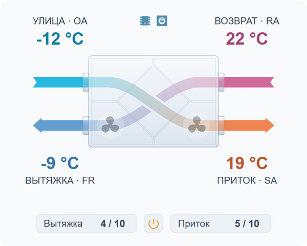

<p align="center">
  
  
</p>

[English](README.en.md)

# ESPHome для Royal Clima

Прошивка для подключения рекуператора **Royal Clima SOFFIO Primo** к ESP32. Позволяет управлять вентиляцией и получать показания через Home Assistant или браузер.

Серия включает **RCS-250-P, RCS-350-P, RCS-500-P и RCS-650-P**. Работа проверена на **RCS-650-P**. Возможна совместимость с **Holtop XHBQ**, но она не проверена.

- [Прошивка для первой установки через USB](bin/royalclima-firmware.factory.bin).
- [Прошивка для обновления по Wi-Fi](bin/royalclima-firmware.ota.bin).
- [Конфигурация ESPHome](RoyalClima.yaml).
- [Документация производителя](docs/).

<p align="center">
  
</p>

## Что потребуется

- Плата **ESP32-WROOM-32**, например ESP32-DevKitC или DevKit V1.
- Преобразователь **UART ↔ RS-485 с логикой 3,3 В**, например модуль на MAX3485 с контактами DI, RO, DE и /RE.
- USB-кабель с передачей данных, питание для ESP32 и провода подключения.
- Сеть Wi-Fi.

Для ESP32-C3, S3 и плат с другими выводами нужна соответствующая настройка конфигурации. Подключение ниже рассчитано на обычную плату ESP32-WROOM-32.

## Подключение

Подключайте провода при отключённом питании ПВУ.

```text
+--------------------+        +------------------------+        +--------------------+
|    Рекуператор     |        |    UART <-> RS-485     |        |       ESP32        |
|                GND | [1]    |                        |        |                    |
|    Порт RS-485   B |<------>| B                   DI |<-------| GPIO17 / TX        |
|                  A |<------>| A                   RO |------->| GPIO16 / RX        |
|                12V | [1]    |               DE + /RE |<-------| GPIO18 / EN        |
|                    |        |                    GND |--------| GND                |
|                    |        |                    VCC |<-------| 3V3 [2]            |
+--------------------+        +------------------------+        |                    |
                                                                | USB / питание      |
                                                                +--------------------+
```

[1] +12 В и GND на разъёме ПВУ — для варианта питания через DC-DC, описанного ниже.

[2] Питание 3,3 В для совместимого модуля MAX3485.

| ESP32 | Преобразователь RS-485 |
|---|---|
| GPIO17 | DI |
| GPIO16 | RO |
| GPIO18 | DE и /RE, соединённые вместе |
| GND | GND |
| 3V3 | VCC модуля на 3,3 В |

Контакты **A и B** преобразователя соедините с **A и B** разъёма RS-485 рекуператора. ESP32 питается через USB или предусмотренный вход питания платы. Названия контактов преобразователя сверяйте с его маркировкой.


На плате рекуператора установите **SW4-4 в положение ON — скорость 9600 бод**. Адрес установки по умолчанию — **1** (параметр 08 штатного пульта). Если изменили его на ПВУ, задайте такой же `modbus_address` в `substitutions` и пересоберите прошивку; `baud_rate` меняется там же. Обе группы опроса используют один адрес.

### Питание от рекуператора

В качестве варианта можно использовать недорогой понижающий **DC-DC 12 → 5 В**, подключив его к контактам **+12 В и GND** того же разъёма RS-485. Выход 5 В подаётся на вход питания ESP32, рассчитанный на 5 В. Модуль подключается к ПВУ четырьмя проводами: **+12 В, GND, A и B**.

**Этот вариант на практике не проверялся.** Нужно проверить допустимую нагрузку выхода 12 В и достаточность питания для ESP32 и преобразователя. Не подавайте 12 В напрямую на ESP32. Не подключайте одновременно USB и питание от DC-DC, если плата не допускает такой режим.

## Установка прошивки

### Готовая прошивка

**Файлы в `bin/` пока не пересобраны под новую настройку Wi-Fi.** Описанный ниже ввод сети через Improv Serial или `royalclima Setup` относится к сборке из обновлённого YAML; старые бинарные файлы могут работать иначе.

1. Подключите ESP32 к компьютеру через USB.
2. Откройте [ESPHome Web](https://web.esphome.io/) в Chrome или Edge, подключитесь к плате и установите файл **factory.bin** по ссылке выше.
3. Если установщик предлагает настройку Wi-Fi по USB (Improv Serial), укажите свою сеть. Иначе подключитесь телефоном или компьютером к открытой сети **royalclima Setup** и откройте `http://192.168.4.1/`: выберите свою сеть 2,4 ГГц и введите пароль.
4. Откройте `http://royalclima.local/` или IP-адрес ESP32 в своей сети.

Для последующих обновлений по Wi-Fi используйте **ota.bin** через ESPHome.

### Установка через ESPHome

1. Добавьте [RoyalClima.yaml](RoyalClima.yaml) в ESPHome Device Builder.
2. При необходимости измените `tx_pin`, `rx_pin`, `en_pin`, `baud_rate` и `modbus_address` в `substitutions`.
3. Выберите «Установить». Первую установку выполните через USB, последующие — по Wi-Fi. Сеть задаётся после прошивки по USB или через **royalclima Setup**, как описано выше; `secrets.yaml` для Wi-Fi не нужен.

Wi-Fi-настройки хранятся на ESP32. Обычное OTA сохраняет их, пока в YAML не заданы SSID и пароль. Полное стирание flash или заводской сброс удаляют настройки; при USB-прошивке со стиранием потребуется повторный ввод. При недоступности сохранённой сети устройство возвращается в режим настройки (тайм-аут резервной точки — 30 секунд). См. [сохранение настроек Wi-Fi в ESPHome](https://esphome.io/components/wifi/#saving-wifi-credentials).

## Возможности

- Включение и выключение вентиляции.
- Раздельный выбор скорости притока и вытяжки: **ступени 0–10**, где 0 — остановка.
- Четыре температуры: наружный воздух, воздух из помещения, приток и выброс воздуха.
- Состояния байпаса, разморозки, пожарного входа и форсирования.
- Наработка вентилятора и настроенный интервал напоминания о фильтре.
- Чтение и изменение заданной влажности и температуры нагревателя.
- Текстовые статусы и ошибки на русском или английском языке; выбор через **Message language**.

Форсирование по датчику зависит от настроек самой ПВУ: **CO₂ или влажность**. Отдельное внешнее форсирование включается замыканием входа «Внешний переключатель» на плате ПВУ.

## Сенсоры и их назначение

Названия приведены так, как они указаны в прошивке. Сущности установки находятся в устройстве **Ventilation System**, диагностика ESP32 — в **Royal Clima**.

### Показания установки

| Название | Назначение |
|---|---|
| Return air temperature | Температура воздуха, забираемого из помещения (RA). |
| Outdoor air temperature | Температура наружного воздуха (OA). |
| Supply Air Temperature | Температура воздуха, подаваемого в помещение (SA). |
| Exhaust air temperature | Температура выбрасываемого воздуха (FR). |
| Supply fan speed | Текущая ступень приточного вентилятора, от 0 до 10; 0 — остановка. |
| Exhaust fan speed | Текущая ступень вытяжного вентилятора, от 0 до 10; 0 — остановка. |
| Humidity setpoint | Заданная влажность, а не измеренная влажность в помещении. |
| Heater temperature setpoint | Заданная температура нагревателя. |
| Filter reminder interval | Настроенный период напоминания о фильтре в днях, а не оставшиеся дни. |
| Fan runtime | Наработка вентилятора в часах. |

Скорости — это ступени, а не обороты или проценты. Влажность — заданное значение, а не измерение. Интервал фильтра — настроенный период, а не оставшиеся дни до обслуживания.

### Состояния установки

| Название | Назначение |
|---|---|
| Vent system Online | Есть актуальные данные от вентиляционной установки. |
| Ventilation power | Установка включена или выключена. |
| Bypass open | Байпас открыт или закрыт. |
| Bypass closed * | Дополнительный признак закрытого байпаса. |
| Defrost active | Активен режим разморозки. |
| Fire alarm | Активен пожарный вход установки. |
| Ventilation error | Установка сообщает об ошибке. |
| External input boost active | Активно форсирование по внешнему входу. |
| Sensor boost active | Активно форсирование по датчику CO₂ или влажности, в зависимости от настроек ПВУ. |
| Ventilation status | Текстовое описание состояния установки на выбранном языке. |
| Error description | Описание ошибок установки на выбранном языке. |

### Диагностика ESP32 и связи

| Название | Назначение |
|---|---|
| WiFi signal | Уровень сигнала Wi-Fi ESP32. |
| Uptime | Время работы ESP32 после перезагрузки, в секундах. |
| ESP32 connection | ESP32 подключён к Home Assistant или другому клиенту ESPHome. |
| Project version | Версия установленной прошивки проекта. |
| Seconds since last data | Сколько секунд прошло с последнего успешного получения основных данных ПВУ. |
| Offline events | Количество сбоев связи после запуска ESP32. |

### Дополнительные служебные сенсоры

Эти значения нужны для диагностики и обычно скрыты. Звёздочкой (*) отмечены сущности, отключённые по умолчанию; при необходимости их можно включить в настройках интеграции ESPHome.

| Название | Назначение |
|---|---|
| Power state raw * | Служебное значение состояния питания установки. |
| Supply fan speed code * | Служебный код скорости приточного вентилятора. |
| Exhaust fan speed code * | Служебный код скорости вытяжного вентилятора. |
| Status flags raw * | Служебное значение состояний установки. |
| Error flags raw * | Служебный код ошибок установки. |
| External input boost signal raw * | Служебный сигнал форсирования по внешнему входу. |
| Sensor boost signal raw * | Служебный сигнал форсирования по датчику CO₂ или влажности. |
| Filter interval code * | Служебный код настроенного периода напоминания о фильтре. |

### Управление и настройки

| Название | Назначение |
|---|---|
| Ventilation control | Включение и выключение установки. |
| Supply speed control | Выбор ступени приточного вентилятора: 0–10. |
| Exhaust speed control | Выбор ступени вытяжного вентилятора: 0–10. |
| Humidity setpoint control * | Изменение заданной влажности: 1–99 %. |
| Heater temperature setpoint control * | Изменение заданной температуры нагревателя: 10–25 °C. |
| Message language | Язык сообщений: ru — русский, en — английский. По умолчанию en; выбор сохраняется. |
| ESP32 Reboot | Перезагрузка только ESP32, без перезапуска контроллера ПВУ. |

## Подключение к Home Assistant

В Home Assistant откройте **Настройки → Устройства и службы** и добавьте обнаруженное устройство ESPHome. Если оно не найдено автоматически, добавьте интеграцию **ESPHome** и укажите IP-адрес ESP32.

Для удобного управления используйте отдельный проект [Royal Clima ERV Card](https://github.com/alidonet/ha-royal-clima-card). Установка и настройка карточки описаны в её репозитории.
Примеры отображения карточки в Home Assistant:




Показания и управление также доступны в браузере по адресу ESP32. Прошивка поддерживает MQTT после настройки подключения к брокеру в YAML.
